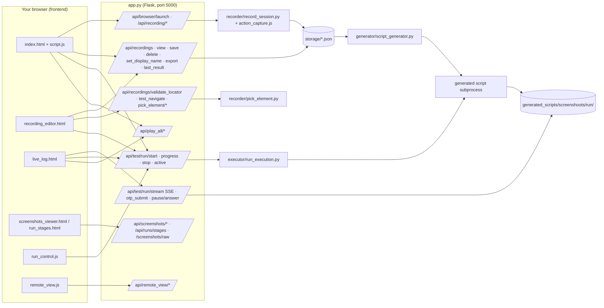

# AutoFlow QA: Beginner's Project Guide

> **How to read this guide.** Every section starts with the idea in plain English and an everyday comparison, then points at the code. File references look like `app.py:959-964`, meaning *file `app.py`, lines 959 to 964*. Line numbers match the files as they were when this guide was written (2026-11-03). If you edit a file, the numbers below it will shift.
>
> I only read the code for this guide. I didn't run it. When something was unclear or looked unused, I say so.

---

## 1. Project overview

### What it does

AutoFlow QA is a **record-and-replay website testing tool**:

1. You type a website address into a small web dashboard and click **Launch Browser**.
2. A real Chrome-style browser (Chromium) opens. Everything you click, type, select or scroll is **recorded** as a list of steps and saved as a JSON file.
3. From that JSON file the tool **writes a Python test script** automatically.
4. Later you click **Replay**. The tool runs that script, which repeats your steps in a fresh browser. It takes screenshots and marks each step pass, fail or warning.
5. A **live log** window shows progress step by step. Afterwards you get an HTML report, screenshots, and an export (ZIP of CSV files). You can also edit the recording, for example to add a "check this text is visible" step.

### Tech stack

| Piece | What it is | Role in this project |
|---|---|---|
| **Python 3** | Programming language | All of the backend (`.python-version` says `3.13`; the README says the bundled venv uses 3.12.7) |
| **Flask 3.0.3** | Small Python web framework | Web server. Serves the HTML pages and every `/api/...` endpoint (`app.py`) |
| **Playwright 1.64.0** | Browser-automation library | Opens Chromium, records actions, and replays them |
| **watchdog 6.0.0** | File-change watcher | Regenerates the test script when a recording JSON is edited outside the app (`app.py:211-372`) |
| **Pillow 10.4.0** | Image library | Compares screenshots pixel by pixel (`validation/compare.py`) |
| **Jinja2 3.1.6** | HTML template engine | Fills in the HTML pages and the HTML report (`templates/*.html`, `validation/report_generator.py:339`) |
| **flask-cors** | CORS helper | Lets another web origin call the API (`app.py:75-76`) |
| **gunicorn** | Production web server | Listed in `requirements.txt`, but nothing in the code or config uses it (see section 10) |
| **HTML + CSS + plain JavaScript** | Frontend | Dashboard, editor, live log, screenshot viewer. No React or other framework |
| **Server-Sent Events (SSE)** | One-way live stream from server to browser | Live replay log (`app.py:4012-4425`, `templates/live_log.html:484`) |
| **Database** | **None.** | Everything is stored as **JSON files and folders** on disk (`storage/repository.py:1-4`: "Everything is flat files for now") |

### Analogy for the whole system: a dance studio with a video camera

- **Dashboard (frontend)** = the **front desk**. You say "I want to learn this routine on this stage (URL)".
- **Recorder** = the **camera operator**, filming every move you make (click, type, scroll) and writing it down as a numbered list.
- **Recording JSON** (`storage/recordings/`) = the **written choreography notes** in the filing cabinet.
- **Script generator** = the **choreographer**, who turns the notes into exact instructions a robot dancer can follow (`generated_scripts/*_script.py`).
- **Executor / replay** = the **robot dancer**, performing the routine on stage while a photographer (screenshots) takes pictures after each move.
- **Live log** = the **commentator**, calling out "step 3 done, step 4 failed..." as it happens.
- **Report / screenshots / export** = the **performance review** handed to you afterwards.
- **Recording editor** = the **notes editor**: cross out a move, add "check the lights are on", rename steps.
- **No database**: the studio keeps everything in labelled folders, not a computer database.

---

## 2. Folder and file map

### Tree view (source and config only; generated and data folders are summarised)

```
automate_testing_tool_new-main/
├── app.py                         # Flask server: all pages + ~45 API routes (4,718 lines)
├── utils.py                       # URL fixing + browser launch options (41 lines)
├── regenerate.py                  # CLI: rebuild .py scripts from recording JSON (49 lines)
├── remote_view.py                 # "Live browser" streaming for cloud (Render) mode (408 lines)
├── requirements.txt               # Python packages
├── .python-version                # "3.13"
├── .gitignore
├── README.md                      # Long setup + usage manual (1,237 lines)
├── config/
│   └── message_keywords.json      # Words that mean "account already exists" during replay
├── generator/
│   ├── __init__.py                # empty
│   └── script_generator.py        # Turns recording JSON → Python replay script (31,104 lines!)
├── recorder/
│   ├── __init__.py                # empty
│   ├── action_capture.js          # JavaScript injected into the recorded page (7,896 lines)
│   ├── record_session.py          # Python side of the recorder (1,884 lines)
│   ├── pick_element.py            # "Pick Element" feature of the editor (1,925 lines)
│   └── page_snapshot.py           # Saves page snapshots (MHTML) while recording (706 lines)
├── executor/
│   ├── __init__.py                # empty
│   └── run_execution.py           # Runs the generated script as a subprocess (776 lines)
├── validation/
│   ├── __init__.py                # empty
│   ├── compare.py                 # Screenshot pixel comparison (155 lines)
│   └── report_generator.py        # Builds report.html + plain-English failure text (477 lines)
├── storage/
│   ├── __init__.py                # empty
│   ├── repository.py              # All JSON read/write (the "database layer") (464 lines)
│   ├── session_files.py           # Finds/deletes every file of one session (113 lines)
│   ├── retention.py               # Age-based cleanup/archiving (245 lines)
│   ├── recordings/                # DATA: recording JSONs (+ edited/ subfolder)
│   ├── snapshots/                 # DATA: page snapshots (.mhtml + .json)
│   ├── executions/                # DATA: empty (nothing writes here, see §10)
│   └── searches/                  # DATA: empty (nothing writes here, see §10)
├── templates/                     # HTML pages (Jinja2)
│   ├── index.html                 # Dashboard
│   ├── recording_editor.html      # Recording editor (3,655 lines, with inline JS)
│   ├── live_log.html              # Live replay log popup (inline JS)
│   ├── run_stages.html            # Screenshot stages of one run
│   ├── screenshots_viewer.html    # Browse all runs' screenshots
│   └── report.html                # HTML report template (server-rendered)
├── static/
│   ├── css/style.css              # All styling (1,690 lines)
│   └── js/
│       ├── script.js              # Dashboard logic (2,380 lines)
│       ├── run_control.js         # Disables Replay buttons while a run is active
│       └── remote_view.js         # Floating "Live Browser" panel (cloud mode only)
├── generated_scripts/             # GENERATED: *_script.py, edited/, screenshoots/<run>/ (≈4,675 files)
├── screenshots/                   # GENERATED: one "launch" screenshot per recording session
├── reports/                       # GENERATED: fallback report folder (currently empty)
├── tests/                         # ≈190 ad-hoc check/probe scripts, fixtures, PNGs, JSON results
├── *.md (29 files)                # Change reports (PHASE_x_REPORT.md, FIX_*.md, AutoFlow_*.md ...)
├── *.json at root                 # Leftover outputs: out.json, test4/5_result.json, video_run_*.json
├── Automation_Testing_Tool_Documentation_Updated_4.docx
├── *.bak_20261103, *.rollback_saved   # Backup copies of source files
├── venv/                          # SKIPPED: Python virtual environment (≈2,164 files)
├── __pycache__/                   # SKIPPED: Python bytecode cache
└── .claude/                       # settings.local.json + worktrees/ (an old full copy of the project)
```

**Skipped (present but not analysed):** `venv/`, every `__pycache__/`, `.claude/worktrees/agent-a8900f878cb86facb/` (an older copy of the whole project), and the generated content inside `generated_scripts/` and `tests/`. There are no lock files, `node_modules`, `dist`, `build` or `.next` folders.

### File table

| File | Type | One-line purpose |
|---|---|---|
| `app.py` | Backend | Flask app: every page, every API, recording thread, file watcher, SSE live stream |
| `utils.py` | Backend | `normalize_url`, auto-dismiss dialogs, Render-safe browser launch options |
| `regenerate.py` | Backend (CLI) | Regenerates scripts from recording JSON files from the command line |
| `remote_view.py` | Backend | Streams the server's browser to the dashboard when running on Render |
| `generator/script_generator.py` | Backend | Recording JSON → standalone Playwright Python script (holds the **whole replay engine**) |
| `recorder/action_capture.js` | Backend-owned JS (runs inside the *tested* site) | Listens to clicks, typing, scrolls etc. and sends them to Python |
| `recorder/record_session.py` | Backend | `Recorder` class: receives events, builds the action list, saves drafts |
| `recorder/pick_element.py` | Backend | Opens a browser at a step so you can click an element to get its XPath |
| `recorder/page_snapshot.py` | Backend | Saves/loads MHTML snapshots of pages per step (masks passwords/OTPs) |
| `executor/run_execution.py` | Backend | Starts the generated script as a subprocess, tracks it, interprets `report.json` |
| `validation/compare.py` | Backend | Screenshot diff with threshold and ignored regions |
| `validation/report_generator.py` | Backend | Builds `report.html`, turns technical errors into plain English |
| `storage/repository.py` | Database (file-based) | Read/write/list/migrate recording JSON; crash recovery |
| `storage/session_files.py` | Database (file-based) | Finds every file belonging to one session; deletes them |
| `storage/retention.py` | Database (file-based) | Archive/delete files older than N days |
| `templates/index.html` | Frontend | Dashboard page structure |
| `templates/recording_editor.html` | Frontend | Recording editor page + all its JS |
| `templates/live_log.html` | Frontend | Live replay log page + JS (SSE, OTP and pause cards) |
| `templates/run_stages.html` | Frontend | Screenshot stages for one run |
| `templates/screenshots_viewer.html` | Frontend | Session → stage → image browser |
| `templates/report.html` | Frontend (server-rendered) | Jinja2 template for the static HTML report |
| `static/js/script.js` | Frontend | Dashboard behaviour |
| `static/js/run_control.js` | Frontend | Polls active runs; disables run buttons |
| `static/js/remote_view.js` | Frontend | Remote live-browser panel (Render only) |
| `static/css/style.css` | Frontend | Styles |
| `config/message_keywords.json` | Config | Keywords that trigger the "field error" pause during replay |
| `requirements.txt` | Config | Python dependencies |
| `.python-version` | Config | Python version hint (`3.13`) |
| `.gitignore` | Config | Ignores venv, storage, generated output, backups |
| `.claude/settings.local.json` | Config (tool) | Claude Code permission (allows one `py_compile` command) |
| `README.md` | Other (docs) | Setup and usage manual |
| `*.md` reports (29) | Other (docs) | Historical change/fix reports |
| `storage/recordings/*.json` | Database (data) | Saved recordings |
| `generated_scripts/**` | Other (generated) | Generated scripts + run folders (screenshots, `report.json`, `report.html`) |
| `tests/**` | Other (tests) | Probe/check scripts. They're not a normal test suite (no pytest config) |

---

## 3. Frontend files explained

**Theory.** The frontend is everything that runs in *your* browser: HTML (the skeleton), CSS (the paint) and JavaScript (the behaviour). It never touches files or Chromium directly. It only sends HTTP requests to the Flask backend (`fetch(...)`) and draws whatever comes back.

**Analogy.** The frontend is the **TV remote**. Pressing a button sends a signal to the TV (backend), and the TV does the real work.

> Note: `recorder/action_capture.js` is JavaScript too, but it runs inside the **website being tested**, not in the dashboard. It's covered under the backend recorder in section 4.

### 3.1 `templates/index.html` + `static/js/script.js` (Dashboard)

**What you see:** a URL box with **Launch Browser** and **Stop Recording** (`index.html:40-60`); a "Browser Launch Result" panel (`:75-120`); a recording status badge (`:134-145`); a **Recorded Tests** list with Select-all, **Play All**, **Export** and **Refresh** (`:160-193`); pagination (`:256-271`); a "Raw Result" box (`:285-288`); and modals for *Name this test*, *Rename* and *Delete* (`:310-359`). It loads `script.js`, `run_control.js` and `remote_view.js` (`:366-376`).

**Main functions in `script.js`:**

| Function / block | Lines | What it does | Backend it calls |
|---|---|---|---|
| `callApi()` | 155 | Generic helper: POST/GET, show result in "Raw Result" | any |
| `renderRecordingStatus()` | 294 | Draws the badge: Launching / Recording / Stopping / Completed / Failed | – |
| `openNameTestModal()` / save | 359, 392 | After recording, asks you to name the test | `POST /api/recordings/set_display_name` |
| `_saveRenameCard()` | 437-443 | Rename a card | `POST /api/recordings/set_display_name` |
| `pollRecordingStatusOnce()` | 476-482 | Polls recording state | `GET /api/recording/status` |
| Launch button handler | 505-522 | Starts recording | `POST /api/browser/launch` |
| Stop button handler | 582-588 | Stops recording | `POST /api/recording/stop` |
| DB button / Status button | 615-623, 636-644 | Calls DB stub / status. **The buttons don't exist in `index.html`**, so this code never runs (see §10) | `/api/database/connect`, `/status` |
| `loadRecordings()` | 657-682 | Loads the list | `GET /api/recordings` |
| `renderRecordingsPage()` | 818 | Pagination | – |
| `createRecordingCard()` | 877 | Builds one card with View/Edit, Replay, Rename, View Last Log, Screenshots, Delete buttons (labels around 960-1103) | – |
| View/Edit button | 969 | Goes to editor | `GET /recording/edit?path=` |
| Screenshots button | 1083 | Goes to the screenshots viewer | `GET /screenshots?session=` |
| `actionTypeLabel()` | 1241 | Friendly names ("Double Click"...) | – |
| `renderResultSummary()` / `renderValidationPanel()` | 1323, 1409 | Draws pass/fail panels | – |
| `renderReplayProgress()` | 1582 | Draws "step 3 of 12" | – |
| `runRecording()` | 1700-1860 | **Replay**: loads the recording, starts the run, opens the live-log window, polls progress | `GET /api/recordings/view`, `POST /api/test/run/start`, opens `/logs?run_id=`, `GET /api/test/run/progress` |
| `_performDeleteRecording()` | 1906-1915 | Deletes a session | `POST /api/recordings/delete` |
| `viewLastLog()` | 1955-1973 | Shows the last result | `GET /api/recordings/last_result` |
| Selection helpers | 2015-2074 | Remember the selected cards (localStorage) | – |
| `runPlayAll()` | 2187-2251 | Replays the selected recordings one after another | `/api/play_all/begin`, `/progress`, `/end` + `runRecording` |
| Export | 2283 | Downloads a ZIP | `POST /api/recordings/export` |
| `DOMContentLoaded` | 2357 | Calls `loadRecordings()` on page load | – |

### 3.2 `templates/recording_editor.html` (editor, with all its JS inline)

**What you see:** the recording's name, action count, start URL, recorded/saved times and stop reason (`:108-200`); the list of steps (`:216-228`); **Add Action**, **Undo Delete** and **Save Edited JSON** (`:232-257`); the *Add Action* modal with action-type dropdown, XPath box, **Validate**, **Pick Element** and **Test Navigate** (`:272-324`); and Rename, Delete-depends and Run-until modals (`:336-381`).

| Function | Lines | What it does | Backend it calls |
|---|---|---|---|
| `loadRecording()` | 440-480 | Loads the recording | `GET /api/recordings/view` |
| `loadLastReplayHealth()` | 568-576 | Shows locator health from the last run | `GET /api/recordings/last_result` |
| `saveRenameRecording()` | 724-728 | Rename | `POST /api/recordings/set_display_name` |
| `deriveActionName()` / `buildAutoStepName()` | 843, 980 | Readable step names (JS copy of the Python naming logic) | – |
| `ACTION_FIELD_DEFS` | 1120 onwards | Which fields each action type needs (click, fill, validate_text, count_elements...) | – |
| `renderActions()` | 1304 | Draws each step with buttons ▶ Run-until (1431), ⬆+ Add before (1453), ✎ Rename (1472), ⚙ Edit (1513), ⬇+ Add after (1535), ✕ Delete (1554) | – |
| `prewarmPickElement()` | 1724-1728 | Starts a background browser early | `POST /api/recordings/pick_element/prewarm` |
| `cancelPickElement()` | 1746-1747 | Closes it | `POST /api/recordings/pick_element/cancel` |
| Test Navigate button | 2218-2235 | Tries a URL | `POST /api/recordings/test_navigate` |
| Validate button | 2258-2276 | Checks the XPath matches | `POST /api/recordings/validate_locator` |
| Pick Element button | 2448-2474 + poll at 2785 | Opens picker, polls for result | `POST /api/recordings/pick_element/start`, `GET .../status` |
| `openAddActionDialog()` | 2867 | Opens the modal (add/edit mode) | – |
| Modal Save | 3087 | Puts the new step into the in-memory list | – |
| Save Edited JSON | ~3395-3410 | Saves | `POST /api/recordings/save` |
| `startRunUntil()` | 3544-3574 | Runs steps 1..N only | `POST /api/test/run/start` with `run_until_step`, opens `/logs?run_id=` |
| `stepOthersMayDependOn()` / `openDeleteDependsDialog()` | 3597, 3617 | Warns when deleting a step that other steps depend on | – |

### 3.3 `templates/live_log.html` (live replay log)

Opened as a separate popup window. It reads `run_id` from the URL and opens an **EventSource** (SSE) to `/api/test/run/stream` (`:484`). It shows a timestamped line per step and updates them (`markStepLine` 502, `setStepLineState` 854).

- **OTP card**: `submitOtp()` (`:635-640`) → `POST /api/test/run/otp_submit`.
- **Pause / field-error card** (website said "already registered" and the like): `renderFieldRows()` 878, `collectFieldValues()` 920, `answerPause()` 942-972 → `POST /api/test/run/pause/answer`.
- **Stop**: `:460` → `POST /api/test/run/stop`. In Play All mode `askQueueStop()` (`:421-441`) → `GET /api/play_all/state`, `POST /api/play_all/stop_all`.

### 3.4 `templates/run_stages.html`

`loadStages()` (`:123-136`) → `GET /api/runs/stages?run_dir=`, then `renderStageList()` 173 and `showStage()` 207. Images load from `/screenshots/raw?path=`.

### 3.5 `templates/screenshots_viewer.html`

Three-level browser: sessions → stages → images. `goToSessions()` 238 → `/api/screenshots/sessions`; `goToStages()` 305 → `/api/screenshots/stages`; `goToImages()` 402 → `/api/screenshots/images`; thumbnails via `/screenshots/raw`.

### 3.6 `templates/report.html`

Not interactive. Jinja2 fills it on the **server** in `validation/report_generator.py:339-477` and saves it as `report.html` in the run folder. You open it with `/run/report?path=` (`app.py:2537-2547`).

### 3.7 `static/js/run_control.js` (64 lines)

Every 1.5 s it polls `GET /api/test/run/active` (`:36`) and disables any element marked `data-af-run-control` while a replay runs (`:16-31`). It exposes `window.AFRunControl` (`:50-56`).

### 3.8 `static/js/remote_view.js` (281 lines)

Asks `/api/remote_view/status` once. If the server isn't in remote (Render) mode it stops there (header comment `:1-6`). Otherwise it shows a floating "Live Browser" panel, polls `/api/remote_view/frame` and sends mouse/keyboard input to `/api/remote_view/input` (`:137`).

### 3.9 `static/css/style.css`

All the visual styling (1,690 lines). No logic.

---

## 4. Backend files explained

**Theory.** The backend is the program running on your computer (the server). It receives HTTP requests, does the real work (opening browsers, reading and writing files, running scripts) and sends JSON or HTML back.

**Analogy.** The **kitchen**: the dashboard (waiter) brings an order such as "replay this test", the kitchen cooks it and sends the plate back.

### 4.1 `app.py`, the Flask server (4,718 lines)

**Startup:** imports (`:24-79`), logging (`:67-72`), `app = Flask(...)` (`:74`), CORS (`:75-76`), registers the remote-view blueprint (`:78-79`). In-memory state: `session_state` (`:92-102`), `_recording_control` (`:113`), `_run_meta` (`:3188`), `_play_all` (`:3428-3430`). Main block (`:4696-4718`): recover crashed drafts → start the file watcher → `app.run(host="127.0.0.1", port=5000, debug=False, threaded=True)`.

**Important helper functions:**

| Function | Lines | Purpose |
|---|---|---|
| `_terminal_enter_reader` | 132-163 | One background thread reads ENTER from the terminal to stop recording |
| `_regenerate_script_after_save` | 166-190 | Shared "JSON saved → regenerate .py" step |
| `_RecordingJsonWatchHandler` / `start_recordings_watcher` | 211-372 | watchdog observer on `storage/recordings/` with 0.4 s debounce |
| `_finish_recording` | 375-516 | Stops the recorder, saves JSON, checks the action count, finalises snapshots, generates the script, updates status |
| `_run_recording_session` | 519-955 | The whole recording lifecycle on its own thread (launch Chromium, goto URL, record, wait for ENTER/Stop/browser close, finish) |
| `_resolve_recording_file` | 1097-1129 | Turns a path from the frontend into a safe path inside `storage/recordings/` (blocks `../` escapes) |
| `_slice_preceding_actions` | 1444-1482 | Steps before an insertion point (for Validate/Pick) |
| `_pick_snapshot_for` | 1485-1506 | Finds a saved page snapshot for that point |
| `_robust_xpath_js` / `_validate_repair_xpath` | 1512-1560 | Builds a better XPath using the recorder's own JS block |
| `_validate_locator_result` | 1756-1847 | Shared end of Validate (checkbox state, value-range preview) |
| `_load_test_case_for_run` | 2993-3030 | Loads the recording for a replay |
| `_screenshot_options_from_body` | 3033-3055 | Optional screenshot-compare settings |
| `_json_on_error` | 3058-3075 | Decorator: any crash → JSON error + traceback in the terminal |
| `_save_field_values_to_recording` | 3337-3382 | Saves new values typed on the field-error card back into the recording |
| `_summarize_steps`, `_step_*` helpers | 3539-4010 | Pass/fail counts, step labels and failure reasons for the live log |
| `_attach_sub_lines_to_steps` | 3788 | Adds sub-lines to steps before the report is built |
| `_export_last_run_dir`, `_export_otp_mask_indexes` | 4436-4486 | Export helpers (masks OTP/password values as `******`) |

**Every route in `app.py`:**

| Method | URL | Line | What it does / data touched |
|---|---|---|---|
| GET | `/` | 959 | Renders `index.html` |
| GET | `/api/recordings` | 970 | Lists recordings (`repository.list_recordings`) |
| POST | `/api/recordings/set_display_name` | 1007 | Writes `display_name` into the recording JSON |
| POST | `/api/recordings/delete` | 1038 | Deletes the recording, its scripts and run folders (`session_files.delete_session`); refuses (409) if a replay is running |
| GET | `/recording/edit?path=` | 1132 | Renders the editor; opens the `_edited.json` copy if one exists (`:1186-1191`) |
| GET | `/api/recordings/view?path=` | 1237 | Returns the recording JSON |
| GET | `/api/recordings/last_result?path=` | 1333 | Finds the newest full-run `report.json` for that recording |
| POST | `/api/recordings/validate_locator` | 1563 | Replays up to a step (or opens a snapshot) and counts XPath matches; may suggest a repaired XPath |
| POST | `/api/recordings/test_navigate` | 1850 | Opens a URL in a fresh browser and reports the title |
| POST | `/api/recordings/pick_element/start` | 1937 | Starts a Pick Element session → `pick_id` |
| POST | `/api/recordings/pick_element/prewarm` | 1991 | Starts a background browser early (always returns success) |
| GET | `/api/recordings/pick_element/status?pick_id=` | 2033 | Polled status (`waiting`/`locked`/`done`/...) |
| POST | `/api/recordings/pick_element/cancel` | 2060 | Closes the picker browser |
| POST | `/api/recordings/pick_element/_test_drive` | 2092 | Test-only hook; 403 unless `AUTOFLOW_TEST_HOOKS=1` (`:2089`) |
| POST | `/api/recordings/save` | 2211 | Saves the edited recording to `storage/recordings/edited/<name>_edited.json` and regenerates the script into `generated_scripts/edited/` |
| GET | `/run/stages?run_dir=` | 2517 | Renders `run_stages.html` |
| GET | `/run/report?path=` | 2537 | Serves a run's `report.html` |
| GET | `/api/runs/stages?run_dir=` | 2550 | Lists stage folders + screenshots |
| GET | `/screenshots/raw?path=` | 2603 | Serves one PNG (only from inside `generated_scripts/screenshoots/`) |
| GET | `/screenshots` | 2623 | Renders `screenshots_viewer.html` |
| GET | `/api/screenshots/sessions` | 2628 | Lists run folders (optional `?session=`) |
| GET | `/api/screenshots/stages` | 2670 | Lists stages of a session |
| GET | `/api/screenshots/images` | 2733 | Lists images |
| POST | `/api/browser/launch` | 2788 | Starts the recording thread; waits until the page loads |
| POST | `/api/recording/stop` | 2875 | Same as pressing ENTER: sets the stop Event |
| GET | `/api/recording/status` | 2933 | Current recording phase |
| GET | `/api/database/connect` | 2954 | **Stub**: always "Database integration is not configured yet." |
| GET | `/status` | 2971 | Health info (`flask: ok`, recording flags) |
| POST | `/api/test/run` | 3078 | **Blocking** replay (waits for the end). Not called by the current frontend, only documented in the README (`README.md:731`) |
| POST | `/api/test/run/start` | 3192 | **Async** replay → `run_id`; supports `run_until_step` |
| POST | `/api/test/run/pause/answer` | 3291 | Writes `pause_answer.json` (and `stop_request.txt` on Stop) into the run folder |
| POST | `/api/test/run/stop` | 3385 | Writes `stop_request.txt` |
| GET | `/api/test/run/active` | 3402 | Active runs + Play All state |
| GET | `/api/play_all/state` | 3442 | Play All queue state |
| POST | `/api/play_all/begin` | 3449 | Creates the queue token |
| POST | `/api/play_all/progress` | 3464 | Heartbeat / progress |
| POST | `/api/play_all/stop_all` | 3480 | Asks the queue to stop |
| POST | `/api/play_all/end` | 3490 | Clears the queue |
| POST | `/api/test/run/otp_submit` | 3512 | Writes `otp_input.txt` into the run folder |
| GET | `/api/test/run/progress?run_id=` | 3592 | Progress; builds `report.html` once when done |
| GET | `/api/test/run/stream?run_id=` | 4012 | **SSE** events: `meta`, `step`, `step_update`, `log`, `step_retry`, `pause`, `pause_resolved`, `otp_needed`, `otp_resolved`, `running`, `summary`, `stream_error` |
| POST | `/api/recordings/export` | 4489 | ZIP with `sessions.csv`, `steps.csv`, `live_logs.csv` + screenshots |
| GET | `/logs` | 4638 | Renders `live_log.html` |
| GET/POST | `/api/maintenance/cleanup` | 4657 | Retention sweep (GET = preview only) |

### 4.2 `remote_view.py` (Flask blueprint)

`REMOTE_MODE = os.environ.get("RENDER") is not None` (`:33`). The `Source` class (`:45-170`) screencasts the active page as JPEG frames and applies queued mouse and keyboard input.

Routes:
- `GET /api/remote_view/status` (`:305`)
- `GET /api/remote_view/frame` (`:324`)
- `POST /api/remote_view/input` (`:357`)

When not on Render, these only answer `{"remote": false}`.

### 4.3 `utils.py`

- `server_safe_launch_kwargs` (`:11-23`): on Render, forces headless and adds `--no-sandbox --disable-dev-shm-usage`.
- `normalize_url` (`:26-33`): adds `https://` if it's missing.
- `attach_dialog_handler` (`:36-41`): auto-dismisses alert/confirm/prompt dialogs.

### 4.4 `recorder/` (capturing your actions)

**Theory.** Playwright can inject a script into every page (`add_init_script`) and expose a Python function to page JavaScript (`expose_binding`). The injected JS listens for DOM events and calls `window.recordAction(...)`, which lands in Python.

**Analogy.** A **court stenographer** sitting in the website: every action gets typed up and passed to the clerk (Python), who decides what goes in the official record.

- **`action_capture.js`**: version marker `:19`. Pick-mode overlay code (`:26-1330`). The shared robust XPath builder between `AFQA-ROBUST-XPATH-BEGIN/END` (`:1331-1416`), also read by `app.py:1512-1517`. `send()` (`:4917`). Event listeners for mousedown/pointer (6089-6184), drag/drop (6386-6504), click (6515), dblclick (7029), contextmenu (7075), focus/blur/input/change (7208-7426), submit (7458), navigation/title (7537-7555), keydown (7561), scroll (7773), visibility (7885).
- **`record_session.py`**: `_CAPTURE_JS` reads `action_capture.js` **once at import** (`:59-63`), so you must restart Flask after editing the JS. `Recorder` class (`:399`): `_record` 599, `_flush_draft` 641 (writes the crash-safe `.draft.jsonl`), `_on_action` 697, `_on_navigate` 971, `install_context_capture` 1381-1408 (`expose_binding("recordAction")` + `add_init_script`), `record_new_tab` 1540, `start` 1571, `stop` 1700 (flushes unfinished typing, records environment: viewport, user agent, locale, ...). Debug flags: `DEBUG_RECORDER` (`:48`), `AUTOFLOW_DEBUG` (`:57`).
- **`page_snapshot.py`**: `RecordingSnapshotter` (`:415`). `tick` 463 is called every 0.5 s from the recording loop. `capture_final` 530. `finalize` 534 links snapshots to steps by time. `mask_mhtml` 328 hides password/OTP inputs. `load_archive` 625 and `open_snapshot_page` 671 serve a snapshot offline for Validate/Pick. Size limits at `:46-47`.
- **`pick_element.py`**: `start_pick_session` 123, `prewarm_pick_session` 195, `cancel_active_pick` 211, `get_pick_status` 235. `_load_resolve_and_act` 261 generates a script and imports its `resolve_and_act`. `_replay_preceding_actions` 363 fast-forwards. `_run_pick_wait_phase` 623 waits for your click. `_WarmPickSession` 1515 keeps a browser alive between picks (idle timeout 600 s, `:101`). Picks time out after 120 s (`:78`).

### 4.5 `generator/script_generator.py` (the replay engine)

**Theory.** Instead of a replay function inside the server, the project **writes a complete Python program** for each recording. The template is one huge text block, `SCRIPT_TEMPLATE` (a `string.Template`, `:37` → `''')` at `:30678`), with blanks like `$steps_literal`. `generate_script()` fills the blanks.

**Analogy.** A **mail-merge letter**: one template, and each recording's data fills in the blanks to produce a personal letter (script).

Key places:
- Inside the template: tunable constants (`:96-201`); `_resolve_element` 10178 (find an element by id, role, text, href, XPath, CSS, bounding box...); `_message_keywords` 11204 (reads `config/message_keywords.json`); `_resolve_checkbox_state` 14078; `resolve_and_act` 20110 (performs one step: click, fill, select, scroll, drag, validate_*, count_*, ...); `_validate_product` 24001; `run()` 24240 (the main replay loop; the first step must be `navigate`, `:24270-24310`); `_stop_requested` 5053; `_pause_and_ask` 5083 (shared pause/answer mechanism); `_wait_for_live_otp` 5878; command-line entry `:30666-30676` (`python script.py [qa_url] [out_json] [shot_dir] [headless] [product]`).
- Real module functions (outside the template): `test_case_has_otp_step` 30681; `_template_otp_helpers` 30725 (exec's part of the template so OTP rules stay shared); `generate_script` 30783-31104 (builds `steps`, fills the template, writes atomically, warns on a step-count mismatch). Output: `generated_scripts/<name>_script.py`, or `generated_scripts/edited/` for edited recordings (`:26-32`).
- Environment variables read by generated scripts: `AUTOFLOW_RUN_UNTIL_STEP`, `AUTOFLOW_LIVE_ACK`, `AUTOFLOW_MESSAGE_KEYWORDS_FILE`, `AUTOFLOW_SNAPSHOT_RECORDING`, `AUTOFLOW_PROJECT_ROOT`, `AUTOFLOW_DEBUG`, `AUTOFLOW_STOP_ON_FAILURE`, `AUTOFLOW_STEP_BUDGET_S`, `AUTOFLOW_READINESS_WAIT`, `AUTOFLOW_ON_PAGE_MISMATCH`, `AUTOFLOW_TIMELINE`, `AUTOFLOW_NEW_TAB_WAIT_*`, `AUTOFLOW_CHAT_*`, `RENDER`.

### 4.6 `executor/run_execution.py`

**Analogy:** the **stage manager**. It starts the robot (subprocess), times it, and reads its scorecard (`report.json`) at the end.

- Timeout: `_compute_script_timeout` (`:75-97`) = 40 s + 30 s × steps (+200 s if there's an OTP step), between 120 s and 1800 s.
- `_prepare_run` 194: run folder `generated_scripts/screenshoots/<slug>_<timestamp>/` + `report.json`.
- `_build_command` 210: uses `venv/bin/python` (or `venv\Scripts\python.exe` on Windows) if present, else the current Python; `"0"` means a visible browser.
- `_finalize_result` 283: adds UI-element status, expected-content check, screenshot compare (`compare.compare_screenshots`) and product validation.
- `execute_test` 503 (blocking `subprocess.run`), `start_replay` 671 (`Popen` + watcher thread `_watch_replay` 606), `_replay_env` 652, `active_run_ids` 646, `poll_replay` 706 (reads the partially written `report.json`).

### 4.7 `validation/`

- `compare.py`: `compare_screenshots` (`:87`), default threshold 0.02 (`:39`), noise floor 8 (`:47`), `_mask_regions` 58 (ignored rectangles).
- `report_generator.py`: `plain_language_reason` 121 and `step_headline` 214 (friendly failure text), `honest_summary` 293, `generate_report` 339 (renders `templates/report.html` into the run folder, falling back to `reports/`).

### 4.8 `regenerate.py`

CLI: `python regenerate.py [file.json ...]`. With no arguments it regenerates every `storage/recordings/*.json` (`:19-44`).

---

## 5. Config and database

### Config files and settings

| File / setting | Controls |
|---|---|
| `config/message_keywords.json` → `keywords` | Phrases ("already exist", "already registered", ...) that, if the website shows them after a form submit during replay, pause the run with a "field error" card. Read at `script_generator.py:11204-11220`; path passed via `AUTOFLOW_MESSAGE_KEYWORDS_FILE` (`run_execution.py:658`) |
| `requirements.txt` | Flask, playwright, Pillow, Jinja2, watchdog (pinned); gunicorn, flask-cors (unpinned) |
| `.python-version` | `3.13` |
| `.gitignore` | Ignores `.env*`, venv, `storage/`, `screenshots/`, generated screenshots, backups, `.claude/worktrees/` |
| `.claude/settings.local.json` | Editor-tool permission only; not used by the app |
| Hard-coded in `app.py` | Host `127.0.0.1`, port `5000`, `PAGE_LOAD_TIMEOUT=30000` ms (`:81`), debounce 0.4 s (`:208`), Play All stale 120 s (`:3428`) |
| `storage/retention.py:41` | `RETENTION_DAYS = 30`, archive folder `retention_archive/` (`:43`) |

**Environment variables** (key names only; no `.env` file exists in the project):

| Variable | Where | Effect |
|---|---|---|
| `FRONTEND_URL` | `app.py:76` | Allowed CORS origin (default `*`) |
| `RENDER` | `utils.py:7`, `remote_view.py:33` | Cloud mode: headless browser + remote live view |
| `AUTOFLOW_TEST_HOOKS` | `app.py:2089` | Enables the test-only `_test_drive` route |
| `DEBUG_RECORDER`, `AUTOFLOW_DEBUG` | `record_session.py:48,57` | Extra recorder logging |
| `AUTOFLOW_*` (others) | generated scripts | Set by `run_execution._replay_env` (`:652-668`) or optional tuning; see 4.5 |

No secrets, passwords or API keys appear in the code or config.

### "Database": files on disk

**Theory.** A database is an organised place to keep data. This project uses **folders of JSON files** instead of a database server. All reading and writing goes through `storage/repository.py`, so that if the project ever moves to a real database, only that file has to change (`repository.py:1-4`).

**Analogy.** A **filing cabinet**: one drawer per kind of document, one folder per test.

| "Table" | Location | Defined at | Contents |
|---|---|---|---|
| Recordings | `storage/recordings/<name>.json` | `repository.py:15`, saved by `save_recording` 39 | Keys seen in a real file: `name, session_id, start_url, recorded_at, stop_reason, total_actions, page_count, viewport_width, viewport_height, device_scale_factor, user_agent, locale, timezone_id, color_scheme, actions, saved_at` (+ optional `display_name`, `recovered`) |
| Each action | inside `actions[]` | built in `record_session.py` | `action_type, value, locator_profile, act_target, state_target, bounding_box, scroll_x/y, click_strategy, page_url, timestamp, dom_context, in_modal, click_offset, popup_container, page_id, post_click, delay_before_ms, result` ... |
| Edited recordings | `storage/recordings/edited/<name>_edited.json` | `repository.py:16`, `save_edited_recording` 50 | Same shape |
| Trimmed recordings | `storage/recordings/trimmed/` | `repository.py:17` | Listed and cleaned up, but no code writes to it |
| Crash drafts | `storage/recordings/<name>.draft.jsonl` | `record_session._flush_draft` 641; recovered by `recover_orphaned_drafts` 376 | One action per line |
| Snapshots | `storage/snapshots/<recording>/<ts>.mhtml/.json` | `repository.py:20`, `page_snapshot.py` | Page archives per step |
| Executions / Searches | `storage/executions/`, `storage/searches/` | `repository.py:18-19`, `save_execution` 362, `save_search` 369 | **Never written**; the functions are never called |
| Generated scripts | `generated_scripts/<name>_script.py`, `edited/` | `script_generator.py:26-32` | Python replay programs |
| Run results | `generated_scripts/screenshoots/<slug>_<ts>/` | `run_execution.py:194-207` | `report.json`, `report.html`, stage subfolders with PNGs, plus hand-off files `otp_input.txt`, `pause_answer.json`, `stop_request.txt`, `live_view.json` |
| Launch screenshots | `screenshots/<ts>/img1.png` | `app.py:590-596` | First screenshot when recording starts |

On load, recordings are migrated in memory (`migrate_recording`, `repository.py:310-315`): auto-created validations are stripped, expected URLs repaired and migrated, and "reveal" steps normalised.

**In-memory state (lost on restart):** `session_state`, `_run_meta`, `_play_all` in `app.py`; `_active_replays` in `run_execution.py`; `_PICK_RESULTS` and `_WARM_SESSIONS` in `pick_element.py`.

---

## 6. How the files are connected

### Python imports (who uses whom)

```
app.py
 ├─ storage.repository, storage.session_files, storage.retention
 ├─ utils
 ├─ recorder.record_session (Recorder)
 ├─ recorder.pick_element ──┬─ generator.script_generator (generate_script)
 │                          ├─ recorder.record_session (_CAPTURE_JS)
 │                          ├─ utils
 │                          └─ remote_view
 ├─ recorder.page_snapshot (imported lazily inside functions) ── storage.repository
 ├─ generator.script_generator ── storage.repository
 ├─ executor.run_execution ──┬─ storage.repository
 │                           ├─ utils
 │                           └─ validation.compare ── storage.repository
 ├─ validation.report_generator ── storage.repository, templates/report.html
 └─ remote_view (Flask blueprint)

recorder.record_session ── reads recorder/action_capture.js as text, storage.repository
regenerate.py ── generator.script_generator
generated script (subprocess) ── reads config/message_keywords.json,
                                  writes run folder files, reads hand-off files
```

### Frontend → backend calls



### How the server and the replay process talk

The replay runs as a **separate process**, so the server and the replay can't share Python variables. They pass notes through files in the run folder:

| File | Written by | Read by |
|---|---|---|
| `report.json` | generated script (per step) | `poll_replay` → `/progress` and `/stream` |
| `otp_input.txt` | `/api/test/run/otp_submit` (`app.py:3531`) | script (`_wait_for_live_otp`) |
| `pause_answer.json` | `/api/test/run/pause/answer` (`app.py:3318-3330`) | script (`_pause_and_ask`) |
| `stop_request.txt` | `/api/test/run/stop` (`app.py:3394`) | script (`_stop_requested`, `script_generator.py:5053`) |
| `live_view.json` | script (Render only, `script_generator.py:5330`) | `remote_view.py` |

---

## 7. Full workflow, step by step

### Flow A: starting the app
1. `python app.py` → `__main__` block (`app.py:4696`).
2. `repository.recover_orphaned_drafts()` turns leftover `.draft.jsonl` files into recordings (`repository.py:376-464`).
3. `start_recordings_watcher()` starts watchdog (`app.py:350-372`).
4. `app.run(127.0.0.1:5000, threaded=True)` (`app.py:4714`).
5. You open `http://127.0.0.1:5000` → `index()` renders `index.html` (`app.py:959-964`) → `DOMContentLoaded` → `loadRecordings()` → `GET /api/recordings` → `repository.list_recordings()` (`repository.py:327-359`) → cards drawn by `createRecordingCard()` (`script.js:877`).

### Flow B: recording a test
1. Type a URL, click **Launch Browser** (`script.js:505`). Status polling starts (`:476`).
2. `POST /api/browser/launch` (`app.py:2788`): `normalize_url`, refuses if a recording is already active (`:2814-2836`), sets phase `launching`, starts `_run_recording_session` in a thread (`:2842-2853`), and waits until the page is ready.
3. Recording thread (`app.py:519`): launches Chromium (headed, falling back to headless) (`:531-547`), `Recorder(page)` + `install_context_capture` (`:561-562`), `page.goto(url)` (`:569`), launch screenshot (`:590-598`), phase `recording` (`:668-673`), `recorder.start()` (`:679`), snapshotter (`:683-691`), new-tab handler (`:698-726`).
4. You use the website. `action_capture.js` listeners → `send()` → `window.recordAction` → `Recorder._on_action_binding` (`record_session.py:1410`) → `_on_action` (`:697`) → `_record` → `_flush_draft` (crash-safe draft). Each action is printed to the terminal.
5. Loop every 0.5 s (`app.py:756-850`): checks whether the browser was closed or is stuck, snapshots `tick()`, waits for the stop Event.
6. Stop happens one of three ways: ENTER in the terminal (`_terminal_enter_reader`, `:132`), **Stop Recording** (`POST /api/recording/stop`, `:2875`), or closing the browser.
7. `_finish_recording` (`app.py:375`): `recorder.stop()` → `repository.save_recording()` → `storage/recordings/session_YYYYMMDD_HHMMSS.json` → remove the draft → `snapshotter.finalize()` → re-read and count check → `generate_script()` → `generated_scripts/session_..._script.py` → phase `completed`.
8. The dashboard poll sees `completed` and shows the **Name this test** modal → `POST /api/recordings/set_display_name` (`app.py:1007`, `repository.set_display_name` 64).

### Flow C: replaying a test (the main flow)
1. Click **Replay** on a card → `runRecording()` (`script.js:1700`).
2. `GET /api/recordings/view` to get `start_url` (`script.js:1718`; `app.py:1237`).
3. `POST /api/test/run/start` with `qa_url` and `recording_path` (`script.js:1733`; `app.py:3192`): Play All guard → `_load_test_case_for_run` (`:2993`) → `generate_script()` (fresh script) → `start_replay()` (`run_execution.py:671`) → `_prepare_run` creates the run folder → `Popen([venv python, script, url, report.json, run_dir, "0", product])` → watcher thread. `_run_meta[run_id]` is stored and the response includes `run_id`.
4. The dashboard opens a popup at `/logs?run_id=...` (`script.js:1780`; `app.py:4638`). `live_log.html:484` opens `EventSource('/api/test/run/stream')`.
5. Inside the subprocess: `run()` (`script_generator.py:24240`) opens Chromium with the recorded viewport/locale, then for each step calls `resolve_and_act` (`:20110`) → `_resolve_element` (`:10178`). It takes screenshots into stage folders and writes `report.json` after every step.
6. The SSE generator (`app.py:4027`) keeps calling `poll_replay(run_id)` (`run_execution.py:706`), which reads the growing `report.json`, and pushes `step`, `log` and other events. The live log updates each line (`live_log.html:502`, `:854`). Meanwhile the dashboard polls `/api/test/run/progress` (`script.js:1801`; `app.py:3592`) for its own progress panel, and `run_control.js` disables the other Replay buttons.
7. **OTP needed?** The script pauses (`_wait_for_live_otp` 5878 → `_pause_and_ask` 5083) → SSE `otp_needed` → you type the code → `POST /api/test/run/otp_submit` → `otp_input.txt` → the script continues.
8. **Website says "already registered"?** A keyword from `config/message_keywords.json` matches → pause card with fields → `POST /api/test/run/pause/answer` → `pause_answer.json`. With **Save**, the new values are also written into the recording (`app.py:3337`).
9. **Stop button** → `POST /api/test/run/stop` → `stop_request.txt` → the script ends before its next step.
10. Process exits → `_watch_replay` → `_finalize_result` (`run_execution.py:283`) adds content/screenshot/product checks → `done=True`.
11. The next `/progress` or `/stream` sees done → `generate_report()` → `report.html` in the run folder (`app.py:3640-3647`) → SSE `summary` → the live log shows the final summary and a link to `/run/report?path=...`; the dashboard shows a stages link `/run/stages?run_dir=` (`script.js:1848`).

### Flow D: editing a recording
1. **View/Edit** → `/recording/edit?path=` (`app.py:1132`), which opens the `_edited.json` version if one exists → editor `loadRecording()` → `/api/recordings/view`.
2. **Add Action** → `openAddActionDialog()` (`:2867`) + `prewarmPickElement()` → `/pick_element/prewarm` (`app.py:1991`).
3. **Pick Element** → `/pick_element/start` (`app.py:1937`) → `start_pick_session` (snapshot, warm browser, or fresh replay up to the step) → you click the element in that browser → the editor polls `/pick_element/status` and fills the XPath.
4. **Validate** → `/validate_locator` (`app.py:1563`): uses a snapshot if there is one, otherwise a turbo replay, counts matches, and may suggest a repaired XPath.
5. **Save Edited JSON** → `POST /api/recordings/save` (`app.py:2211`) → `save_edited_recording` → `storage/recordings/edited/<name>_edited.json` → script regenerated into `generated_scripts/edited/`. The original file is never touched.
6. ▶ on a step → **Run until step N** → `/api/test/run/start` with `run_until_step` + `step_check` (`recording_editor.html:3557`; `app.py:3209-3227`) → the env var `AUTOFLOW_RUN_UNTIL_STEP` limits the run.

### Flow E: Play All, Export, Delete, Screenshots, Cleanup
- **Play All**: `runPlayAll()` (`script.js:2187`) → `/api/play_all/begin` (token) → for each selected recording: `runRecording()` with the token → 15 s heartbeat `/api/play_all/progress` → `/api/play_all/end`. Other replays are blocked meanwhile (`app.py:3199-3202`).
- **Export**: `POST /api/recordings/export` (`app.py:4489`) builds an in-memory ZIP: `sessions.csv`, `steps.csv` (OTP/password values masked), `live_logs.csv`, `screenshots/...`.
- **Delete**: confirm modal → `POST /api/recordings/delete` (`app.py:1038`) → `session_files.delete_session` (`session_files.py:88`).
- **Screenshots**: `/screenshots` page → `/api/screenshots/sessions` → `stages` → `images` → `/screenshots/raw`.
- **Cleanup**: no button exists. Call `GET /api/maintenance/cleanup` to preview, or `POST {"dry_run": false}` to actually run it (`app.py:4657`; `retention.run_cleanup` 130).

---

## 8. Feature-to-code index

| Feature | Frontend file:lines | Backend file:lines | Database / other | How it works |
|---|---|---|---|---|
| Launch browser + auto-record | `script.js:505-580` | `app.py:2788-2872`, `519-955` | `screenshots/<ts>/img1.png` | Thread owns Playwright; recording starts after page load |
| Action capture | – | `recorder/action_capture.js`, `record_session.py:697,1381-1435` | – | JS events → `recordAction` binding → Python |
| Stop via ENTER | – | `app.py:132-163`, `730-750` | – | One shared stdin reader sets the session's Event |
| Stop via button | `script.js:582-600` | `app.py:2875-2930` | – | Sets the same Event |
| Recording status badge | `script.js:294, 476` | `app.py:2933-2951` | in-memory `session_state` | Polling |
| Crash-safe drafts + recovery | – | `record_session.py:641-695`, `repository.py:376-464`, `app.py:4698-4703` | `*.draft.jsonl` | Append-only sidecar, rebuilt on next start |
| Page snapshots | – | `page_snapshot.py:415-596` | `storage/snapshots/` | MHTML per step, secrets masked |
| Auto script generation | – | `app.py:166-190`, `script_generator.py:30783` | `generated_scripts/` | Template fill on every save |
| External-edit watcher | – | `app.py:211-372` | `storage/recordings/**` | watchdog + 0.4 s debounce |
| CLI regenerate | – | `regenerate.py` | – | Manual batch regeneration |
| List recordings + pagination | `script.js:657, 818` | `app.py:970`, `repository.py:327` | recordings, edited, trimmed | Sorted by `saved_at` |
| Name / rename test | `script.js:359-460`, `recording_editor.html:711-755` | `app.py:1007-1035`, `repository.py:64` | `display_name` field | File name never changes |
| Delete session | `script.js:1890-1948` | `app.py:1038-1094`, `session_files.py:70-113` | JSON, scripts, run folders | Blocked while a replay runs (409) |
| View / edit recording | `recording_editor.html:440, 1304` | `app.py:1132-1330` | prefers `_edited.json` | – |
| Add / edit / delete / rename step | `recording_editor.html:1453-1580, 2867, 3087` | – (in-memory until save) | – | `ACTION_FIELD_DEFS` decides the fields |
| Undo delete | `recording_editor.html:3330` | – | – | Client-side |
| Delete-dependency warning | `recording_editor.html:3597-3650` | – | – | Warns when a later step depends on the deleted one |
| Orphaned assertion warning | `recording_editor.html:1937-2030` | – | – | Compares XPath tokens with earlier steps |
| Save edited recording | `recording_editor.html:~3395-3410` | `app.py:2211-2399`, `repository.py:50` | `edited/<name>_edited.json` | Original untouched |
| Validate XPath (+ auto-repair) | `recording_editor.html:2258-2430` | `app.py:1563-1847` | snapshot or live | Count matches; robust XPath suggestion |
| Pick Element | `recording_editor.html:2448-2866` | `app.py:1937-2087`, `pick_element.py` | snapshot | Click an element in a real browser to get its locator |
| Prewarm / cancel picker | `recording_editor.html:1724-1760` | `app.py:1991, 2060`, `pick_element.py:195, 211, 1515` | – | Background browser kept warm |
| Test navigate URL | `recording_editor.html:2218-2256` | `app.py:1850-1934` | – | One-shot browser |
| Replay (async) | `script.js:1700-1888` | `app.py:3192-3288`, `run_execution.py:671` | run folder | Subprocess + watcher thread |
| Replay (blocking API) | – (README only) | `app.py:3078-3185`, `run_execution.py:503` | run folder | `subprocess.run` |
| Run until step N | `recording_editor.html:3513-3596` | `app.py:3205-3227`, `run_execution.py:652-668` | `partial_run` in report | `AUTOFLOW_RUN_UNTIL_STEP` env var |
| Live log (SSE) | `live_log.html:484-1130` | `app.py:4012-4425` | `report.json` | Server polls the file and streams events |
| Progress panel | `script.js:1582, 1800` | `app.py:3592-3685` | – | Polling |
| Run control (disable buttons) | `run_control.js` | `app.py:3402-3425` | – | 1.5 s poll |
| Stop a replay | `live_log.html:460` | `app.py:3385-3399` | `stop_request.txt` | File flag |
| OTP live entry | `live_log.html:635-640` | `app.py:3512-3536`, `script_generator.py:5878` | `otp_input.txt` | File hand-off |
| Field-error pause + save values | `live_log.html:867-972` | `app.py:3291-3382`, `script_generator.py:5083, 11204` | `pause_answer.json`, `config/message_keywords.json` | Keyword match pauses; answer resumes |
| Play All queue | `script.js:2015-2260`, `live_log.html:421-441` | `app.py:3428-3509` | in-memory `_play_all` | Token + heartbeat |
| HTML report | link in live log | `report_generator.py:339`, `app.py:2537` | `report.html` | Jinja2 |
| Plain-English failure text | – | `report_generator.py:121-320`, `app.py:3742-3786` | – | Regex table → sentences |
| View last log | `script.js:1955-2013`, `recording_editor.html:568` | `app.py:1333-1438` | newest `report.json` | Folder-name prefix match |
| Screenshot stages | `run_stages.html` | `app.py:2517-2620` | stage subfolders | – |
| Screenshot browser | `screenshots_viewer.html` | `app.py:2623-2785` | – | – |
| Screenshot comparison | – (API body only) | `compare.py:87`, `run_execution.py:283+`, `app.py:3033` | baseline image | Pixel diff with threshold/regions |
| Expected content check | – (API body only) | `run_execution.py:283+` | – | Text contained in final page |
| Product validation | – (API body only) | `script_generator.py:24001` | – | Searches the final page for a product name |
| Export ZIP/CSV | `script.js:2283` | `app.py:4436-4635` | ZIP in memory | OTP/password masked |
| Retention cleanup | – (no UI) | `app.py:4657-4693`, `retention.py` | `retention_archive/` | Dry-run by default |
| Remote live browser (cloud) | `remote_view.js` | `remote_view.py` | `live_view.json` | Screencast + input relay |
| Auto-dismiss dialogs | – | `utils.py:36-41` | – | `page.on("dialog")` |
| URL normalisation | – | `utils.py:26-33` | – | Adds `https://` |
| Input validation | many | e.g. `app.py:1018-1027, 1594-1606, 3205-3227, 3300-3305, 4670-4682` | – | Checks types, ranges and path containment |
| Path-traversal protection | – | `app.py:1097-1129, 2407-2445`, run_id checks `3299, 3390, 3523` | – | `relative_to(...)` checks |
| Error handling → JSON | – | `app.py:3058-3075` | – | `_json_on_error` decorator |
| Logging | `console.log` in JS | `app.py:67-72` + `logger` everywhere | `console` output saved per run (`run_execution.py:554`) | Python `logging` |
| CORS | – | `app.py:75-76` | – | `FRONTEND_URL` env |
| Database connect | dead button code `script.js:615` | `app.py:2954-2968` | – | **Stub only** |
| System status | dead button code `script.js:636` | `app.py:2971-2990` | – | Health JSON |
| Authentication / login | – | – | – | **None.** No auth anywhere; the server binds to localhost only |
| File uploads | – | – | – | **None.** No upload endpoint |

---

## 9. How to run the project

Based on `README.md` (Windows steps at `:132-219`, running at `:227-250`), `requirements.txt` and `app.py:4696-4718`:

1. Install Python 3 (README says 3.12.7; `.python-version` says 3.13).
2. Create a virtual environment. The included `venv/` was built on another machine, and the README suggests recreating it (`README.md:159-170`):
   - Windows: `python -m venv venv` then `venv\Scripts\activate`
   - macOS/Linux: `python3 -m venv venv` then `source venv/bin/activate`
3. Run `pip install -r requirements.txt`.
4. Run `playwright install chromium` (required; `README.md:188-197`).
5. Run `python app.py`.
6. Open **http://127.0.0.1:5000** (host and port are hard-coded in `app.py:4714-4718`).

Notes:
- **Keep the terminal open.** Pressing ENTER there stops a recording. If no terminal is attached, use the Stop Recording button (`app.py:139-157`).
- The replay uses `venv/bin/python` (or `venv\Scripts\python.exe`) if it exists (`run_execution.py:218-224`), so packages must be installed in that venv.
- **No env variables are required** for local use. Optional ones are listed in section 5.
- After editing `recorder/action_capture.js` or any `.py` file, restart the server (`debug=False`, and the JS is read once at import, `record_session.py:59-63`).
- To regenerate scripts by hand: `python regenerate.py [path/to/recording.json]`.

---

## 10. Honest observations (listed only, not fixed)

**Unused or dead code**
1. `connectDbBtn` and `systemStatusBtn` handlers (`static/js/script.js:40-48, 615-655`): those element ids don't exist in `templates/index.html`, so this code never runs.
2. `/api/database/connect` (`app.py:2954-2968`) is a stub that always says "not configured".
3. `repository.save_execution` (`storage/repository.py:362`) and `save_search` (`:369`) are never called, so `storage/executions/` and `storage/searches/` stay empty.
4. `TRIMMED_RECORDINGS_DIR` (`repository.py:17`) is listed, watched and cleaned up, but no code ever writes to it.
5. `/api/test/run` (blocking replay, `app.py:3078`) isn't used by the current frontend. Only the README's curl example uses it.
6. Unused imports in `app.py:28-30, 63`: `shutil`, `tempfile`, `subprocess`, `SCRIPT_TIMEOUT_SEC`, `_compute_script_timeout` (they only appear in the import line or in comments).
7. `retention.preview_cleanup` (`retention.py:122`) isn't called by the app (the route uses `run_cleanup(dry_run=True)` instead).
8. `gunicorn` is in `requirements.txt`, but there's no Procfile, start script or other config that uses it. The app only starts via `app.run()`.

**Duplicated logic**
9. OTP detection exists in the template and as `test_case_has_otp_step` (`script_generator.py:30681-30719`). The docstring admits the duplication. Part of it is shared via `exec` (`:30725-30736`).
10. Step naming exists in Python (`_derive_action_name`, `script_generator.py:798`) and in JS (`deriveActionName`, `recording_editor.html:843`).
11. `actionTypeLabel` is defined in both `script.js:1241` and `recording_editor.html:1088`.
12. `_slug` exists in `run_execution.py:100` and inside the template (`script_generator.py:308`). `session_files.py:45` says it must stay in sync with the executor's version.
13. Launch-browser-with-headless-fallback code is repeated in `app.py:533-547`, `1624-1630` and `1880-1886`.

**Confusing parts**
14. `generator/script_generator.py` is **31,104 lines**, and nearly all of it is one string (`SCRIPT_TEMPLATE`, `:37-30678`). Editors can't syntax-check it as code, `$` must be written `$$`, and functions inside it can't be imported (which is why `pick_element.py:261` generates a script and loads it to reach `resolve_and_act`).
15. The folder name `screenshoots` (sic) is used consistently in code (`app.py:2402`, `run_execution.py:205`), alongside a separate `screenshots/` folder for launch images.
16. `app.py` imports `BASE_DIR` twice: once defined locally (`:38`), then overwritten by `from storage.repository import BASE_DIR` (`:53`). Both point to the project root, so behaviour is the same.
17. `from flask_cors import CORS` sits in the middle of the file (`app.py:75`) instead of with the other imports.
18. Python version mismatch: `.python-version` = 3.13, README = 3.12.7.
19. A lot of in-memory state (`_run_meta`, `_active_replays`, `_play_all`, pick sessions) is lost on restart. `poll_replay` returns "Unknown run_id" after a restart (`app.py:3603-3607`, `4103`).
20. There's no authentication. That's fine for `127.0.0.1`, but CORS defaults to `*` (`app.py:76`).

**Clutter in the project folder**
21. Many backup copies sit next to the real files: `*.bak_20261103`, `*.bak_20261103_seeall`, `*.rollback_saved` (for example `app.py.rollback_saved`, `generator/script_generator.py.bak_20261103`, `templates/*.html.bak_20261103`).
22. 29 change-report `.md` files and a `.docx` in the root, plus leftover outputs (`out.json`, `test4_result.json`, `test5_result.json`, `video_run_*.json`) and `FEATURE_REPORT_rewind_reorder.md.rollback_removed`.
23. `.claude/worktrees/agent-a8900f878cb86facb/` is a full older copy of the project (ignored by `.gitignore`).
24. `tests/` has about 190 ad-hoc probe and check scripts, PNGs, JSON results and shell scripts. There's no test runner config (no pytest.ini or conftest), and many look like one-off investigations (`dragscroll_*`, `tabopen_investigate*`, `_apply_patch_*.py`).
25. `generated_scripts/` contains about 4,675 files, including hand-made helper scripts that weren't generated from recordings (`item6_name_check_script_v*.py`, `item_c_icon_check*.py`, `sportzia_flaky_test.py`, `task1_095629_test.py`).
