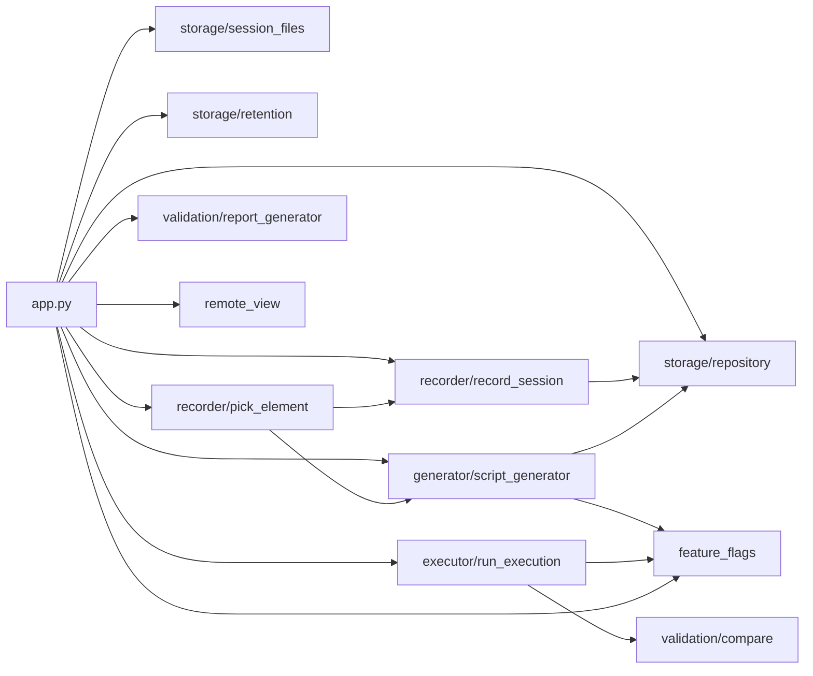

# AutoFlow QA – Project Guide (current code)

## 0. Header

| | |
|---|---|
| Analysis date | 2026-11-04 |
| Core files analysed in depth | 36 (all project source / config files outside `tests/`, incl. 6 empty `__init__.py`) |
| Test scripts skimmed | 165 (161 `.py` + 4 `.sh` in `tests/`, first lines only) |
| Data folders | sampled (a few examples per folder) |
| Line numbers | match the code **on this date**. Any later edit can shift them. |

Skipped on purpose (they exist, but were not analysed): `venv/`, `__pycache__/` (also inside `backend/*`),
`_archive/`, `_backup_seven_changes/`, `_backup_folders_stop_newtab/`, `_backup_no_warning_dashboard/`,
`.claude/` (Claude Code settings + worktrees), `.git/`.

> Note: `docs/` was empty when this guide was written. Older guides/report files are no longer there. This guide
> does not reuse any old line numbers.

---

## 1. What the project does

AutoFlow QA is a **record-and-replay testing tool for websites**. You open a website through it, click around
like a normal user, and it writes down every action. Later it can **replay** those actions in a real browser,
check that every step still works, and give you a report with screenshots.

**The 5-step story:**

1. You type a website URL on the dashboard and click **Launch Browser** (you pick a folder for the test first).
2. A real Chromium window opens. You click, type and scroll. Every action is captured live.
3. You stop the recording (close the browser, click **Stop Recording**, or press ENTER in the terminal).
   The steps are saved as a JSON file, and a Python replay script is generated from it.
4. You click **Replay** (or **Play All** for a folder). The script runs in its own browser and a **live log**
   window shows each step as PASS / FAILED / NOT RUN.
5. You get a result badge on the card, an HTML report, screenshots per stage, and you can export everything
   as a ZIP.

**Tech stack**

| Tool | What it is | Job in this project |
|---|---|---|
| Python 3 | Programming language | The whole backend (`app.py`, `backend/`) |
| Flask 3.0.3 | Small Python web server | Serves the dashboard pages and the `/api/...` routes (`app.py`) |
| flask-cors | Flask add-on | Allows cross-origin calls (`app.py:76-77`) |
| Playwright 1.64.0 (sync API) | Browser automation library | Opens Chromium for recording, replay, Pick Element, Validate |
| Chromium | Browser | The browser that is recorded and replayed |
| watchdog 6.0.0 | File-watching library | Regenerates a script when a recording JSON is edited by hand (`app.py:212-374`) |
| Jinja2 3.1.6 | HTML template engine | Fills the HTML pages and the HTML report (`report_generator.py`) |
| Pillow 10.4.0 | Image library | Screenshot comparison (`compare.py`) and screenshot checks in the replay script |
| gunicorn | Production web server | Listed in `requirements.txt` for cloud hosting (Render); not used locally |
| JavaScript (plain, no framework) | Browser language | Dashboard, editor and live-log logic; the in-page recorder `action_capture.js` |
| HTML + CSS | Page structure / looks | `frontend/templates/*.html`, `frontend/static/css/style.css` |
| JSON files | Plain text data | Recordings, reports – there is **no database** |
| Server-Sent Events (SSE) | One-way live stream | Live log updates (`/api/test/run/stream`) |

---

## 2. Big picture

**One line:** the dashboard is a remote control; the Flask server is the manager; the recorder writes down
what you do; the generator turns that into a robot script; the robot (replay subprocess) does it again and
writes a diary (`report.json`) that the live log reads.

**Analogy:** a cooking show. You cook a dish once while a writer (recorder) notes every move. An editor
(generator) turns the notes into a recipe card (Python script). A robot chef (replay subprocess) cooks from the
card in its own kitchen (its own browser) and writes what happened in a diary. The host (Flask) reads the
diary out loud to the audience (live log) and hands out the review (HTML report).

```
 ┌──────────────── Browser tab: Dashboard (index.html + script.js) ────────────────┐
 │ Launch Browser · folder list · cards · Replay · Play All · Export · Delete       │
 └───────────────┬───────────────────────────────────────────────▲─────────────────┘
                 │ fetch /api/...                                 │ JSON
 ┌───────────────▼────────────────────── Flask server (app.py) ───┴─────────────────┐
 │ recording thread ──► Recorder (record_session.py) ◄── action_capture.js (in page)│
 │        │ save JSON                                                               │
 │        ▼                                                                         │
 │ data/recordings/<folder>/session_X.json ──► generate_script() ──► session_X_script.py
 │                                                                       │          │
 │ start_replay() (run_execution.py) ── subprocess ──────────────────────┘          │
 │        ▲  reads report.json / writes stop_request.txt, pause_answer.json         │
 └────────┼─────────────────────────────────────────────────────────────────────────┘
          │ files in data/generated_scripts/screenshoots/<run_id>/
 ┌────────┴──────────── Replay subprocess (generated script, own Chromium) ──────────┐
 │ run(): for each step → find element → act → check → screenshot → report.json      │
 └────────────────────────────────────────────────────────────────────────────────────┘
          ▲ SSE /api/test/run/stream
 ┌────────┴──────── Popup window: Live log (live_log.html) ──────────────────────────┐
 │ step lines · Stop / Stop this test / Stop all tests · report link                  │
 └────────────────────────────────────────────────────────────────────────────────────┘
```

---

## 3. Folder structure (current)

```
automate_testing_tool_new-main/
├── app.py                     # Flask server: every page + API route, recording thread, live log stream
├── requirements.txt           # Python packages to install
├── README.md                  # Long setup/usage guide (written for Windows)
├── .python-version            # "3.13" (pyenv-style hint)
├── .gitignore                 # Files git should ignore
├── backend/                   # All Python logic (imported as backend.X)
│   ├── feature_flags.py       # 3 on/off switches for paused features
│   ├── utils.py               # URL clean-up, dialog auto-dismiss, server-safe browser args
│   ├── remote_view.py         # Live browser view for cloud hosting (Render only)
│   ├── executor/run_execution.py   # Starts/watches/stops the replay subprocess, finalises results
│   ├── generator/script_generator.py # The replay engine (big template) + generate_script()
│   ├── recorder/
│   │   ├── action_capture.js  # JavaScript injected into recorded pages: captures clicks/typing/...
│   │   ├── record_session.py  # Recorder class: receives actions, builds the recording
│   │   ├── page_snapshot.py   # Saves page snapshots (MHTML) per step for Pick Element
│   │   └── pick_element.py    # "Pick Element" browser session for the editor
│   ├── storage/
│   │   ├── repository.py      # Read/write recordings, folders, migrations, crash recovery
│   │   ├── session_files.py   # Which files belong to one session (Delete)
│   │   └── retention.py       # Age-based cleanup / archive
│   └── validation/
│       ├── compare.py         # Screenshot comparison
│       └── report_generator.py# HTML report + plain-English error texts
├── frontend/
│   ├── templates/             # HTML pages (Jinja templates)
│   │   ├── index.html         # Dashboard
│   │   ├── recording_editor.html # View/Edit a recording
│   │   ├── live_log.html      # Live replay log popup
│   │   ├── run_stages.html    # Screenshots of one run, by stage
│   │   ├── screenshots_viewer.html # Browse all screenshots
│   │   └── report.html        # HTML report template (filled by report_generator.py)
│   └── static/
│       ├── css/style.css      # Shared styles for all pages
│       └── js/
│           ├── script.js      # Dashboard logic
│           ├── run_control.js # Greys out Replay/Run buttons while a run is active
│           └── remote_view.js # Remote live browser panel (cloud only)
├── config/message_keywords.json # "already exists" phrases (feature currently paused)
├── scripts/regenerate.py      # Command-line tool: regenerate replay scripts
├── tests/                     # 190 one-off test/probe scripts, fixtures, results (old layout – see §15)
├── docs/                      # Documentation (this guide)
├── data/                      # Everything the app writes at runtime
│   ├── recordings/            # Recording JSON files (+ <folder>/, edited/, trimmed/)
│   ├── generated_scripts/     # Replay scripts + screenshoots/<run_id>/ run folders + fill_diagnostics/
│   ├── snapshots/             # Page snapshots (per recording name, and per session id)
│   ├── screenshots/           # One launch screenshot per Launch Browser
│   ├── reports/               # Fallback place for HTML reports (empty)
│   ├── executions/            # Created on start, never written to (unused)
│   └── searches/              # Created on start, never written to (unused)
└── (skipped) venv/ _archive/ _backup_*/ .claude/ __pycache__/ .git/
```

| Folder | Kind | What lives there | Do I edit it? |
|---|---|---|---|
| `/` (root) | Backend + Docs + Config | `app.py`, README, requirements | `app.py` only for server changes |
| `backend/` | Backend | All Python logic | Yes, for behaviour changes |
| `backend/recorder/` | Backend (+ JS run inside recorded pages) | Recording capture | Carefully – capture is sensitive |
| `backend/generator/` | Backend | Replay engine template | Carefully – it is a `string.Template` (see §15) |
| `frontend/templates/` | Frontend | HTML pages | Yes, for page changes |
| `frontend/static/` | Frontend | CSS + JS | Yes |
| `config/` | Config | Keyword list | Yes (plain JSON) |
| `scripts/` | Other (tool) | Regenerate CLI | Rarely |
| `tests/` | Other (tests) | Old one-off checks | No (outdated imports) |
| `docs/` | Docs | Guides | Yes |
| `data/` | Data | Runtime files | No – the app writes these (you may delete old runs) |
| `venv/`, `_archive/`, `_backup_*` | Other | Python env / old copies / backups | No |

---

## 4. Every file: type, purpose, why it's needed

### 4.1 Core files

| Path | Type | What it does | Why the project needs it | Lines |
|---|---|---|---|---|
| `app.py` | Backend | Flask app: 46 routes (pages + API), recording thread, file watcher, live-log SSE, export, play-all state | The single entry point (`python app.py`) | 4885 |
| `requirements.txt` | Config | 7 packages: Flask, playwright, Pillow, Jinja2, watchdog, gunicorn, flask-cors | Install list | 7 |
| `README.md` | Docs | Long setup + usage guide | Explains how to install/run | 1246 |
| `.python-version` | Config | Says `3.13` | Python version hint for pyenv | 1 |
| `.gitignore` | Config | Ignore rules (venv, caches, run outputs…) | Keeps git clean | 57 |
| `backend/__init__.py` (+ 5 sub-package `__init__.py`) | Backend | Empty | Makes folders importable as packages | 0 each |
| `backend/feature_flags.py` | Config (Python) | 3 flags, all `False` | One place to pause/unpause features | 35 |
| `backend/utils.py` | Backend | `normalize_url`, `attach_dialog_handler`, `server_safe_launch_kwargs` | Shared small helpers | 41 |
| `backend/remote_view.py` | Backend | Flask blueprint with 3 `/api/remote_view/*` routes; screencast + remote input | Lets a cloud user see/use the server's browser | 408 |
| `backend/executor/run_execution.py` | Backend | Starts the replay subprocess, timeouts, instant stop, finalises `report.json` | Bridge between server and replay | 924 |
| `backend/generator/script_generator.py` | Backend | `SCRIPT_TEMPLATE` (the whole replay engine, lines 38-30925) + `generate_script()` | The only replay implementation | 31355 |
| `backend/recorder/action_capture.js` | Backend (JS injected into pages) | Listens to clicks, typing, scroll, drag, submit… in the recorded page; builds locator profiles | Captures what the user does | 7896 |
| `backend/recorder/record_session.py` | Backend | `Recorder` class: receives actions, tracks tabs/navigations, drafts, final JSON | Builds the recording | 1928 |
| `backend/recorder/page_snapshot.py` | Backend | Saves MHTML snapshots per step; masks passwords/OTP; opens a snapshot for picking | Pick Element without replaying | 706 |
| `backend/recorder/pick_element.py` | Backend | Pick Element browser sessions (warm sessions, snapshot mode, fresh mode) | Editor's "Pick Element" button | 1925 |
| `backend/storage/repository.py` | Backend | JSON read/write, folders, in-memory migrations, list, crash recovery | Single place for recording files | 565 |
| `backend/storage/session_files.py` | Backend | Finds every file of one session; deletes them | Delete button | 118 |
| `backend/storage/retention.py` | Backend | Archive/delete files older than N days | Cleanup route | 255 |
| `backend/validation/compare.py` | Backend | Pixel comparison of two screenshots | Optional screenshot check | 155 |
| `backend/validation/report_generator.py` | Backend | Plain-English reasons, step headlines, HTML report | Report + live-log text | 477 |
| `config/message_keywords.json` | Config | 8 "already exists"-type phrases | Field-error pause (paused) | 13 |
| `frontend/templates/index.html` | Frontend | Dashboard page | Main screen | 405 |
| `frontend/templates/recording_editor.html` | Frontend | Editor page (HTML + ~3300 lines of inline JS) | View/Edit a recording | 3655 |
| `frontend/templates/live_log.html` | Frontend | Live log popup (inline JS, SSE) | Watch a replay live | 1238 |
| `frontend/templates/run_stages.html` | Frontend | One run's screenshots by stage | Results viewing | 239 |
| `frontend/templates/screenshots_viewer.html` | Frontend | Browse sessions → stages → images | Results viewing | 485 |
| `frontend/templates/report.html` | Frontend (report template) | Jinja template of the HTML report | Report layout | 548 |
| `frontend/static/css/style.css` | Frontend | Shared styles (dashboard, editor, viewers, live log) | Looks | 1818 |
| `frontend/static/js/script.js` | Frontend | All dashboard logic | Dashboard behaviour | 2819 |
| `frontend/static/js/run_control.js` | Frontend | Polls `/api/test/run/active`, disables marked buttons | Prevents double runs | 64 |
| `frontend/static/js/remote_view.js` | Frontend | Remote browser panel (only when server says remote) | Cloud use | 281 |
| `scripts/regenerate.py` | Other (tool) | Regenerate scripts from JSON files | Manual regeneration | 49 |

### 4.2 `tests/` (skimmed only)

`tests/` has 190 entries: 161 Python scripts, 4 `.sh` run scripts, 13 JSON result files, 9 PNG screenshots, 1 ZIP
trace, `fixtures/` (local HTML pages + an audit run) and `_probe_out/` (probe outputs). Almost every script says
in its first line that it is **"TEST-ONLY"** or a **"One-off patch applier (TEST-SIDE helper)"**. Examples:

| File | Lines | First line says |
|---|---|---|
| `tests/_apply_patch_mappers.py` | 137 | One-off patch applier: drag tier-ordering |
| `tests/acceptance_live.py` | 124 | Records a manual flow on a live site with the real Recorder |
| `tests/checkbox_fix3_check.py` | 165 | FIX 3 checks for checkboxes |
| `tests/classifier_check.py` | 194 | Mismatch policy + page-generated input, offline |
| `tests/dashboard_ui_check.py` | 94 | Checks on the real dashboard (server on port 5001) |
| `tests/dragscroll_final_run.sh` (…4) | – | Shell runners for drag/scroll checks |

**Important:** 130 of the 161 Python files import the *old* layout (`from generator…`, `from storage…`,
`'generator/script_generator.py'`), and none import `backend.` – so most of them would not run against today's
folders (see §15). They are not used by the app.

### 4.3 Data folders (examples)

| Folder | Example | Naming |
|---|---|---|
| `data/recordings/` | `session_20261103_100245.json` | `session_<YYYYmmdd_HHMMSS>.json` (ungrouped) |
| `data/recordings/<folder>/` | `myntra/session_20261104_090228.json` | same name, inside the chosen folder |
| `data/recordings/edited/` | `session_20261103_111817_edited.json` | `<name>_edited.json` |
| `data/recordings/<folder>/edited/` | (none yet) | edited copy of a folder recording |
| `data/recordings/trimmed/` | empty | listed and deletable, but **nothing in the code writes there** |
| `data/generated_scripts/` | `session_20261006_184845_script.py` | `<name>_script.py` |
| `data/generated_scripts/edited/` | `session_20261012_105400_edited_script.py` | `<name>_edited_script.py` |
| `data/generated_scripts/screenshoots/` | `session_20261104_090228_20261104_095947/` | `<slug(name)>_<YYYYmmdd_HHMMSS>` (the spelling "screenshoots" is real) |
| `data/generated_scripts/fill_diagnostics/` | `enter_name_to_displa_20261014_163037_914682.png` | screenshot of a failed fill |
| `data/snapshots/<recording name>/` | `session_20261103_100245/2026-11-03T04-32-46.787Z.mhtml` + `.json` | step snapshot + meta |
| `data/snapshots/<session id>/` | `4a572d3f…/2026-11-04T05-15-37-530Z.html.gz` | gzip HTML at hard navigations |
| `data/screenshots/` | `20261103_100244/img1.png` | first screenshot of each Launch Browser |

---

## 5. Frontend files in detail

### 5.1 Dashboard – `frontend/templates/index.html` + `frontend/static/js/script.js`

**What I see:** a URL box, **Launch Browser**, a recording status panel, "Recorded Tests" with Export /
Refresh, a folder list (or one opened folder), a Play All message panel, pagination, a "Raw Result" box,
and pop-ups (Choose a folder, Name this test, Rename, Delete).

HTML element lines in `index.html`: `websiteUrlInput` 40 · `launchBrowserBtn` 53 · `stopRecordingBtn` 60 ·
`browserResultPanel` 75-125 · `recordingStatusPanel` 134-150 · `selectAllRecordings` 161 (hidden at start) ·
`playAllBtn` 178 (hidden at start) · `exportRecordingsBtn` 188 · `refreshRecordingsBtn` 195 · `playAllPanel` 207-218 ·
`recordingsList` 251 · `recordingsPagination` 258-275 · `resultOutput` 290 · `nameTestModal` 312-325 ·
`folderModal` 331-351 · `renameCardModal` 357-372 · `deleteCardModal` 378-390. Scripts: `script.js?v=31` 395,
`run_control.js` 400, `remote_view.js` 404.

| Feature / button | Handler (script.js) | Backend route |
|---|---|---|
| Generic API helper + Raw Result box (warning fields hidden) | `callApi` 160-298 (`_withoutWarningFields` 1646) | any |
| Recording status badge + polling | `renderRecordingStatus` 299-362, `pollRecordingStatusOnce` 486-510 | `GET /api/recording/status` (492) |
| Launch Browser → folder popup | listener 594-597 → `openFolderModal` 527-550 | `GET /api/recordings/folders` (538) |
| Folder popup: Launch / Cancel / Enter / Esc | `_confirmFolder` 555-582, `closeFolderModal` 551, listeners 583-592 | `POST /api/recordings/folders/validate` (564) |
| Actual launch | `launchBrowserWithFolder` 601-670 | `POST /api/browser/launch` (616) |
| Stop Recording | listener 672-701 | `POST /api/recording/stop` (680) |
| "Name this test" popup (after recording) | `openNameTestModal` 369, Save 395-422 | `POST /api/recordings/set_display_name` (402) |
| Load recordings (first load, Refresh) | `loadRecordings` 749-900 | `GET /api/recordings` (774) |
| Folder list (📁 name · N tests, "Ungrouped tests") | `_renderFolderList` 1005-1037 | – |
| Open folder / Back to folders | `openFolder` 972, `closeFolder` 979, breadcrumb in `renderRecordingsPage` 1039-1145 | – |
| Remember open folder (`#folder=` in the URL) | `_readOpenFolderFromHash` 927, `_writeOpenFolderToHash` 936 | – |
| Select All + Play All moved into the open folder | `_placeScopedControls` 988-1003 | – |
| Test card | `createRecordingCard` 1146-1475 | – |
| View / Edit | 1229-1245 | page `/recording/edit` |
| Replay | 1257-1286 → `runRecording` 2039-2236 | `/api/recordings/view` (2063), `/api/test/run/start` (2078), `/api/test/run/progress` (2146), opens `/logs` (2125) |
| Rename | 1295-1311 → `_saveRenameCard` 447-472 | `POST /api/recordings/set_display_name` (453) |
| View Last Log | 1318-1332 → `viewLastLog` 2308-2366 | `GET /api/recordings/last_result` (2323) |
| Screenshots | 1339-1360 | page `/screenshots?session=` |
| Delete (+ confirm popup) | 1366-1380 → `deleteRecording` 2243, `_performDeleteRecording` 2259-2296 | `POST /api/recordings/delete` (2268) |
| Card checkbox | 1397-1412 | – |
| Result badge (Passed/Failed/Stopped/Not run; "Warning" hidden) | `_setCardBadge` 1588-1611, `_outcomeOfResult` 1578 | `last_result` field of `/api/recordings` |
| Validations line | `_validationsLine` 1560-1576, `_isCardValidationType` 1556 | `action_type_counts` field |
| TEST PASSED/FAILED summary | `renderResultSummary` 1667-1742 | – |
| Validation cards + "Show all steps" | `renderValidationPanel` 1749-1920 | screenshot links `/screenshots/raw` (1799) |
| Live progress inside the card | `renderReplayProgress` 1922-2032 | – |
| Select All (folder only) | `updateSelectAllState` 2403, listener 2413-2428 | – |
| Play All (folder) + confirm panel | listener 2547-2571, Start 2576-2596, `runPlayAll` 2602-2699 | `/api/play_all/begin` 2606, `/progress` 2614/2641/2676, `/end` 2682 |
| Stop All (in folder toolbar) | `stopPlayAll` 2516-2523 | `/api/play_all/stop_all` 2521, `/api/test/run/stop` 2522 |
| Export | listener 2701-2756 | `POST /api/recordings/export` (2722) |
| Refresh / Previous / Next | 2759-2790 | – |
| Start-up | `DOMContentLoaded` 2796-2819 | – |
| Dead code: Database / System status buttons | 707-747 | `/api/database/connect` 715, `/status` 736 – **the buttons do not exist in index.html** |

### 5.2 Live log – `frontend/templates/live_log.html`

**What I see:** a heading with the test name, the current step, stop buttons, and one line per step
(Running → PASS / WARNING / FAILED / NOT RUN / STOPPED BY USER), details, a summary banner and a report link.

| Feature | Lines |
|---|---|
| Header + stop buttons (`stopRunBtn` "Stop", `stopThisTestBtn`, `stopAllTestsBtn`) | 280-288 |
| Old OTP prompt (`#otpPrompt`) | 292-299 |
| Old queue-stop dialog (`#queueStopCard`, kept, unused) | 301-308 |
| Pause card (`#pauseCard`: OTP / failure / field-error cards) | 310-326 |
| Step lines container `#logLines` | 327 |
| Paused-feature flags from the server | 332-334 |
| `exactReasonHtml` (exact failure reason line) | 337-339 |
| `askQueueStop` (old dialog logic, unused) | 442-477 |
| `hideStopButtons` / `showStopButtons` | 481-497 (calls `/api/play_all/state` 487) |
| `directStop` (one-click stop) | 499-529 (calls `/api/play_all/stop_all` 513, `/api/test/run/stop` 518) |
| Button listeners | 530-532 |
| `_legacyStopRunWithDialog` (kept, unused) | 535-560 |
| SSE connect `EventSource('/api/test/run/stream')` | 565 |
| Events: `meta` 595, `running` 609, `step_update` 663, `log` 707, OTP submit 725-752 (`/api/test/run/otp_submit` 730), `otp_needed` 763, `otp_resolved` 776, `step` 792-950, `pause` 1090-1146, `pause_resolved` 1148, `step_retry` 1164, `summary` 1174-1212 (report link `/run/report` 1203), `stream_error` 1214, `error` 1224 |
| Field-error card helpers (`renderFieldRows`, `collectFieldValues`) | 966-1039 |
| Pause answers (`answerPause` / `answerPauseNow`) | 1041-1088 (calls `/api/test/run/pause/answer` 1071) |

### 5.3 Recording editor – `frontend/templates/recording_editor.html`

**What I see:** the recording's name (with Rename), its steps as rows, and buttons: Add Action, Undo Delete,
Save Edited JSON. Each row has ▶ (run until here), ⬆︎+ / ⬇︎+ (add before/after), ✎ (rename step), ⚙ (edit),
✕ (delete). The Add/Edit dialog has XPath, **Validate**, **Pick Element** and (for navigate) **Test Navigate**.

| Feature | Function (lines) | Route |
|---|---|---|
| Load recording | `loadRecording` 440-566 | `GET /api/recordings/view` (469) |
| Locator health from last replay | `loadLastReplayHealth` 568-608, `classifyLocatorHealth` 617 | `GET /api/recordings/last_result` (573) |
| Header + Rename | `renderRecording` 644, `openRenameRecordingModal` 711, `saveRenameRecording` 724-746, listener 748-750 | `POST /api/recordings/set_display_name` (728) |
| Labels / step names | `ACTION_TYPE_LABELS` 780, `deriveActionName` 843, `buildAutoStepName` 980, `actionTypeLabel` 1088 | – |
| Field definitions per action type (incl. `readOnly` validations) | `ACTION_FIELD_DEFS` 1120-~1300 | – |
| Step list + row buttons | `renderActions` 1304-~1680 (▶ 1427, ⬆︎+ 1453, ✎ 1472, ⚙ 1513, ⬇︎+ 1535, ✕ 1554) | – |
| Pick Element prewarm / cancel | `prewarmPickElement` 1724, `cancelPickElement` 1746 | `/pick_element/prewarm` (1728), `/pick_element/cancel` (1747) |
| Add/Edit dialog fields | `renderModalFields` 2031, `populateActionTypeDropdown` 2176 | – |
| Test Navigate | listener 2218-2256 | `POST /api/recordings/test_navigate` (2235) |
| Validate (XPath) | listener 2258-~2440 | `POST /api/recordings/validate_locator` (2276) |
| Pick Element | listener 2448-~2860, polling 2786 | `/pick_element/start` (2474), `/pick_element/status` (2786) |
| Open Add/Edit dialog | `openAddActionDialog` 2867 | – |
| Dialog Cancel / Save | 3061 / 3087 | – |
| Add Action / Undo Delete | 3313-3380 | – |
| Save Edited JSON | 3382-3500 | `POST /api/recordings/save` (3404) |
| Run until step N | `openRunUntilDialog` 3513, `startRunUntil` 3544-3595 | `POST /api/test/run/start` with `run_until_step` (3557), opens `/logs` (3572) |
| Delete step with dependants | `stepOthersMayDependOn` 3597, `openDeleteDependsDialog` 3617 | – |

### 5.4 Other pages and small JS files

| File | What I see | Key lines | Routes |
|---|---|---|---|
| `run_stages.html` | One run's screenshots grouped by stage | `loadStages` 123, `renderStageList` 173, `showStage` 207 | `/api/runs/stages` (134), `/screenshots/raw` (226) |
| `screenshots_viewer.html` | Sessions → stages → images with breadcrumb | `goToSessions` 238, `goToStages` 305, `goToImages` 402, `buildThumb` 458 | `/api/screenshots/sessions` (251), `/stages` (315), `/images` (413), `/screenshots/raw` (464, 472) |
| `report.html` | The HTML report (Jinja) | title 5, heading 81, validation summary 97-140, checks 151-175, product validation 176-240 | images via `/screenshots/raw` (460) or embedded data URIs |
| `run_control.js` | No UI; greys out buttons marked `data-af-run-control` | `apply` 15-32, `poll` 34-49, `window.AFRunControl` 51-58 | `GET /api/test/run/active` (36, 54) |
| `remote_view.js` | Floating "remote browser" panel (only when the server is remote) | `buildPanel` 29, `send` 125, `attachInput` 147 | `/api/remote_view/status` 263, `/frame` 225, `/input` 137 |
| `style.css` | Shared styles; dashboard folder view 1751-1818; result badges 1725-1747 | – | – |

---

## 6. Backend files in detail

### 6.1 `app.py` – every route

| Method | URL | Lines | Function | What it does | Called from |
|---|---|---|---|---|---|
| GET | `/` | 971-981 | `index` | Dashboard page | browser |
| GET | `/api/recordings` | 982-1031 | `api_recordings` | Lists recordings (+ `folder`, `action_type_counts`, `last_result`) and `folders` | `script.js:774` |
| GET | `/api/recordings/folders` | 1068-1074 | `api_recordings_folders` | Existing folders for the popup | `script.js:538` |
| POST | `/api/recordings/folders/validate` | 1075-1084 | `api_recordings_folders_validate` | Checks a folder name (creates nothing) | `script.js:564` |
| POST | `/api/recordings/set_display_name` | 1085-1115 | `api_recordings_set_display_name` | Name / rename a test (display_name only) | `script.js:402, 453`; editor 728 |
| POST | `/api/recordings/delete` | 1116-1174 | `api_recordings_delete` | Deletes a session's JSON, scripts, run folders, snapshots | `script.js:2268` |
| GET | `/recording/edit` | 1210-1324 | `recording_editor` | Editor page (opens the edited copy if one exists) | `script.js:1239` |
| GET | `/api/recordings/view` | 1325-1420 | `api_recordings_view` | Full recording JSON | `script.js:2063`; editor 469 |
| GET | `/api/recordings/last_result` | 1421-1531 | `api_recordings_last_result` | Newest full report.json of a recording (prefix match) | `script.js:2323`; editor 573 |
| POST | `/api/recordings/validate_locator` | 1651-1843 | `api_recordings_validate_locator` | Replays earlier steps (or a snapshot) and checks an XPath; repair suggestion | editor 2276 |
| POST | `/api/recordings/test_navigate` | 1938-2024 | `api_recordings_test_navigate` | Opens a URL headless to check it loads | editor 2235 |
| POST | `/api/recordings/pick_element/start` | 2025-2078 | `api_recordings_pick_element_start` | Starts a pick session | editor 2474 |
| POST | `/api/recordings/pick_element/prewarm` | 2079-2120 | `api_recordings_pick_element_prewarm` | Prepares a warm browser early | editor 1728 |
| GET | `/api/recordings/pick_element/status` | 2121-2147 | `api_recordings_pick_element_status` | Polls the pick result | editor 2786 |
| POST | `/api/recordings/pick_element/cancel` | 2148-2176 | `api_recordings_pick_element_cancel` | Cancels a pick | editor 1747 |
| POST | `/api/recordings/pick_element/_test_drive` | 2180-2298 | `api_recordings_pick_element_test_drive` | Test hook, only with `AUTOFLOW_TEST_HOOKS=1` (`_TEST_HOOKS_ENABLED` 2177) | tests only |
| POST | `/api/recordings/save` | 2299-2503 | `api_recordings_save` | Saves an edited copy + regenerates its script | editor 3404 |
| GET | `/run/stages` | 2614-2633 | `run_stages_page` | Stages page | card link `script.js:2197` |
| GET | `/run/report` | 2634-2646 | `run_report_page` | Serves a run's report.html | live log 1203 |
| GET | `/api/runs/stages` | 2647-2699 | `api_runs_stages` | Stage folders + images of one run | `run_stages.html:134` |
| GET | `/screenshots/raw` | 2700-2719 | `screenshots_raw` | Serves one image file (path-checked) | many |
| GET | `/screenshots` | 2720-2724 | `screenshots_viewer_page` | Viewer page | `script.js:1353` |
| GET | `/api/screenshots/sessions` | 2725-2766 | `api_screenshots_sessions` | Lists run folders | viewer 251 |
| GET | `/api/screenshots/stages` | 2767-2829 | `api_screenshots_stages` | Stages of one run | viewer 315 |
| GET | `/api/screenshots/images` | 2830-2884 | `api_screenshots_images` | Images of one stage | viewer 413 |
| POST | `/api/browser/launch` | 2885-2994 | `api_browser_launch` | Validates folder, creates it, starts the recording thread, waits until the page loaded | `script.js:616` |
| POST | `/api/recording/stop` | 2995-3052 | `api_recording_stop` | Same stop as ENTER (sets the Event) | `script.js:680` |
| GET | `/api/recording/status` | 3053-3073 | `api_recording_status` | Recording phase for the dashboard | `script.js:492` |
| GET | `/api/database/connect` | 3074-3090 | `api_database_connect` | Placeholder: "not configured yet" | dead button (`script.js:715`) |
| GET | `/status` | 3091-3112 | `status` | Simple health JSON | dead button (`script.js:736`) |
| POST | `/api/test/run` | 3198-3307 | `api_test_run` | **Blocking** replay (old style, waits for the result) | not called by any page (README curl example) |
| POST | `/api/test/run/start` | 3312-3413 | `api_test_run_start` | Generates the script, starts the replay, returns `run_id` | `script.js:2078`; editor 3557 |
| POST | `/api/test/run/pause/answer` | 3414-3466 | `api_test_run_pause_answer` | Writes `pause_answer.json` for a waiting card | live log 1071 |
| POST | `/api/test/run/stop` | 3515-3533 | `api_test_run_stop` | Writes `stop_request.txt` + `request_stop()` | live log 518; `script.js:2522, 2660` |
| GET | `/api/test/run/active` | 3534-3559 | `api_test_run_active` | Runs in progress + Play All state | `run_control.js:36, 54` |
| GET | `/api/play_all/state` | 3574-3580 | `api_play_all_state` | Is a Play All queue running? | live log 487 (and 443, unused dialog) |
| POST | `/api/play_all/begin` | 3581-3595 | `api_play_all_begin` | Starts a queue, returns a token | `script.js:2606` |
| POST | `/api/play_all/progress` | 3596-3611 | `api_play_all_progress` | Heartbeat + "stop_all?" answer | `script.js:2614, 2641, 2676` |
| POST | `/api/play_all/stop_all` | 3612-3630 | `api_play_all_stop_all` | Marks the queue stopped and stops its current run | live log 513; `script.js:2521` |
| POST | `/api/play_all/end` | 3631-3652 | `api_play_all_end` | Ends the queue | `script.js:2682` |
| POST | `/api/test/run/otp_submit` | 3653-3679 | `api_test_run_otp_submit` | Writes `otp_input.txt` (old OTP prompt; paused) | live log 730 |
| GET | `/api/test/run/progress` | 3733-3833 | `api_test_run_progress` | Run progress; when done: result + HTML report (3785) | `script.js:2146` |
| GET | `/api/test/run/stream` | 4169-4592 | `api_test_run_stream` | SSE live log events; writes `.alive/.ack/.logack`; HTML report (4317) | live log 565 |
| POST | `/api/recordings/export` | 4650-4798 | `api_recordings_export` | ZIP: sessions.csv, steps.csv, live_logs.csv, screenshots/ (OTP/passwords masked) | `script.js:2722` |
| GET | `/logs` | 4799-4823 | `live_log_page` | Live log page (passes the 3 flags) | `script.js:2125, 2127, 2628`; editor 3572 |
| GET/POST | `/api/maintenance/cleanup` | 4824-4864 | `api_maintenance_cleanup` | Retention sweep (GET = preview only) | manual only |
| GET | `/api/remote_view/status` | `backend/remote_view.py:305-322` | `api_remote_view_status` | Is remote mode on / which source | `remote_view.js:263` |
| GET | `/api/remote_view/frame` | `remote_view.py:324-355` | `api_remote_view_frame` | Latest JPEG frame | `remote_view.js:225` |
| POST | `/api/remote_view/input` | `remote_view.py:357-381` | `api_remote_view_input` | Mouse/keyboard input to the remote page | `remote_view.js:137` |

**Total: 46 routes in `app.py` + 3 in the `remote_view` blueprint = 49.**

**Other important parts of `app.py`:**

| Part | Lines | Job |
|---|---|---|
| Path setup, imports | 24-79 | `BASE_DIR`, Flask app with `frontend/templates` + `frontend/static` (75), CORS (76-77), remote blueprint (79-80) |
| `session_state`, `state_lock`, `_recording_control`, `_terminal_reader` | 93-130 | In-memory recording state |
| `_terminal_enter_reader` | 133-165 | One process-wide reader for ENTER in the terminal |
| `_regenerate_script_after_save` | 167-207 | Shared "save → regenerate script" step |
| `_RecordingJsonWatchHandler` + `start_recordings_watcher` | 209-374 | watchdog: external JSON edit → regenerate |
| `_finish_recording` | 377-521 | Stop recorder, save JSON (into folder), finalise snapshots, generate script, set "completed" |
| `_run_recording_session` | 523-970 | The recording thread: launch Chromium, goto URL, launch screenshot (597-602), `recorder.start` (685), new-tab hook (704-731), stop loop (766-865), save (869, 911) |
| `_run_outcome`, `_last_run_outcome` | 1032-1067 | Card badge outcome from the newest full run |
| `_resolve_recording_file` | 1175-1209 | Safe path resolution (never outside `data/recordings`) |
| Validate helpers | 1532-1650, 1844-1937 | Slice steps, pick snapshot, robust XPath JS (1600, read from `action_capture.js` markers), count/repair |
| Run-folder helpers | 2504-2613 | Safe run dir / screenshot / stage paths, image sorting |
| `_load_test_case_for_run`, `_screenshot_options_from_body`, `_json_on_error` | 3113-3197 | Shared by run routes |
| `_run_meta` (+ lock) | 3308-3309 | In-memory info per run (recording path, actions, html_report) |
| `_save_field_values_to_recording` | 3467-3514 | Field-error card "Save to recording" (paused feature) |
| `_play_all` state + `_play_all_snapshot` | 3560-3572 | Play All queue state (token, stop_all, run_id) |
| `_summarize_steps`, `_step_state`, `_step_ref`, `_step_display_status` | 3680-3882 | Status mapping for the live log |
| `_step_exact_reason`, `_step_failure_reason` | 3883-3944 | Exact + plain reason payload |
| `_attach_sub_lines_to_steps`, `_step_element_label`, … | 3945-4168 | Readable labels, sub-lines for the report |
| `_export_last_run_dir`, `_export_otp_mask_indexes` | 4593-4649 | Export helpers |
| Start-up block | 4866-4885 | Draft recovery, watcher, `app.run(127.0.0.1:5000, threaded=True)` |

### 6.2 `backend/executor/run_execution.py` (924 lines)

**Job:** start the replay script as a separate process, watch it, stop it, and turn its `report.json` into
the final result.

| Function / constant | Lines | What it does |
|---|---|---|
| `SCRIPT_TIMEOUT_SEC`, `BASELINE_OVERHEAD_SEC`, `SECONDS_PER_STEP`, `MAX_TIMEOUT_SEC`, `OTP_WAIT_TIMEOUT_BUFFER_SEC` | 36-74 | Time limits (120 s min, 40 + 30 s/step, max 1800 s, +200 s OTP) |
| `_compute_script_timeout` | 77-101 | Per-run time limit (OTP buffer only if the OTP flag is on, 96) |
| `_slug` | 103-114 | Safe run-folder name part |
| `_fail_result` | 116-133 | Empty FAIL result |
| `_build_ui_elements` | 147-195 | UI-element table for the report |
| `_prepare_run` | 197-211 | Builds `run_id` and creates `data/generated_scripts/screenshoots/<run_id>/` |
| `_build_command` | 213-228 | `venv/bin/python <script> <qa_url> <report.json> <run_dir> 0 <product>` |
| `_complete_steps` | 236-287 | Marks missing steps FAILED / NOT RUN after a crash |
| `_finalize_result` | 289-509 | Reads report.json, adds checks (content, screenshot, product), message, PASS/FAIL |
| `execute_test` | 511-560 | Blocking run (used only by `/api/test/run`) |
| `_save_console_output` | 562-585 | Writes `replay_console.txt`, links it in report.json |
| `_paused_seconds`, `_communicate_excluding_pauses` | 587-613 | Time spent waiting on a card does not count |
| `STOP_GRACE_S`, `_descendant_pids`, `_kill_process_tree` | 616-659 | Instant stop: process tree kill (`taskkill /T /F` on Windows, `ps` + SIGKILL elsewhere) |
| `request_stop` | 661-686 | After 1 s grace, kills the replay + browser |
| `_write_forced_stop_state` | 688-742 | Writes "Stopped by user" + NOT RUN steps into report.json after a kill |
| `_watch_replay` | 744-789 | Watcher thread: wait, save console, finalise, store result |
| `active_run_ids` | 791-795 | Runs still running |
| `_replay_env` | 797-814 | Env vars for the subprocess |
| `start_replay` | 816-851 | Popen + watcher thread; registry entry with `proc` |
| `poll_replay` | 853-924 | Reads the live report.json (keeps `last_raw`) or returns the final result |

### 6.3 `backend/generator/script_generator.py` (31,355 lines)

**One line:** a giant text template (`SCRIPT_TEMPLATE`, lines 38-30925) that *is* the replay program, plus a
small module part (30928-31355) that fills it in for one recording.

**Analogy:** a form letter. The template is the letter; `generate_script()` fills in the blanks (`$steps_literal`,
`$start_url_literal`, …) and saves it as a new `.py` file.

**Module part (outside the template):**

| Function | Lines | Job |
|---|---|---|
| `OUTPUT_DIR`, `EDITED_OUTPUT_DIR` | 26-32 | `data/generated_scripts/` and `/edited/` |
| `test_case_has_otp_step` | 30928-30969 | Is there an OTP step? (for the timeout buffer) |
| `_template_otp_helpers` | 30972-30984 | Executes the template's OTP helper section so server and replay use one rule |
| `_checkbox_named_by_value_fixed` | 30986-31028 | Fixes old checkbox names recorded as their value |
| `generate_script` | 31030-31355 | Migrates the recording, builds `STEPS`, fills the template (flags 31326-31328), writes `<name>_script.py` atomically |

**Inside the template – feature map** (all line numbers are template lines = file lines):

| Feature | Functions (start line) |
|---|---|
| Header, imports, settings | docstring 38-61, imports 62-76, `_DEBUG` 81, `STEPS` 97, `PROD_URL` 98, timing constants 105-201 |
| Timing between steps | `_parse_timestamp` 205, `_merged_duplicate_gap_ms` 217, `_is_merged_duplicate_of_previous` 230, `_replay_delay` 278, `_step_delay` 293 |
| Screenshots + stages | `_slug` 309, `_derive_stage_name` 322, `_should_take_step_screenshot` 431, `_get_stage_dir` 476, `_capture_screenshot_when_settled` 490, `_capture_screenshot` 595, `_capture_screenshot_core` 637 |
| Step names / header print | `_describe_step` 686, `_derive_action_name` 799, `_print_step_header` 984 |
| URL mapping prod → QA | `_classify_navigate_url` 1130, `to_qa_url` 1157 |
| Element finding (locator tiers) | `_by_attr` 1182, `_find_by_id` 1196, `_find_by_role` 1206, `_resolve_via_role_or_text` 1285, `_find_by_href` 1356, `_find_by_text_tag` 1836, `_find_by_text_tag_number_normalized` 2085, `_score_candidates_and_pick` 2256, `_find_by_css` 2546, `_find_by_xpath` 2567, `_find_by_image_ancestor_or_title` 2588, `_find_by_icon_identity` 2978, `_find_by_position` 3043, `_find_by_accessible_identity` 6797, `_find_in_iframes` 9856, `_resolve_element` 10309, `_resolve_element_with_strategy` 10346, `_resolve_with_timeout` 10399 |
| Final decision on a candidate | `_verify_resolved_target` 9050-9406, `_final_decision` 19474-19570, `_identity_compare` 6741 |
| Live-log handshake | `_wait_log_ack` 3182, `_sub_line` 3201, `_live_phase` 4926, `_wait_live_ack` 4957 |
| Overlays / pop-ups / consent | `_blocking_popup_over` 3377, `_try_dismiss_overlay` 3404, `_maybe_dismiss_consent_overlay` 7905, `_handle_close_target` 8512, `_clear_transient_overlay` 8743, site pop-ups 12155-12302 |
| Click handling | `_arm_click_effect_tracking` 3647, `_check_click_had_effect` 3704, `_trusted_mouse_click` 6208, `_verify_click_target_hit_test` 6513, `_click_at_recorded_offset` 9015, `smart_click` 9646-9813 |
| Typing (fill) | `_do_fill` 3902, `_fill_with_page_awareness` 4120-4322, `_diagnose_fill_select_failure` 23167 (writes `fill_diagnostics/`) |
| Hover reveal (menus) | `_reveal_by_triggers` 4658, `_reveal_via_ancestor_hover` 4694, hover chain 10015-10308, `_wait_for_hover_reveal` 15602 |
| Settings: budget / stop on failure / page mismatch / flags | `STEP_TIME_BUDGET_S` 4163, `STOP_ON_FAILURE` 4173, `ON_PAGE_MISMATCH_DEFAULT` 4183, flags 4189-4191 |
| Notes for the live log | `_url_note_log` 4875, `_otp_flow_log` 4898, `_add_step_detail` 4991, `_add_step_warning` 4999 |
| Run until step N | `_run_until_step` 5051 |
| Stop request | `_stop_requested` 5060 |
| Pause engine (cards) | `PAUSE_ANSWER_FILE`/`PAUSE_CARD_TIMEOUT_S` 5075-5076, `_viewer_present` 5080, `_pause_and_ask` 5090-5181, `_StepCursor` 5182 |
| Browser closed detection | `_watch_replay_browser` 5223, `_replay_browser_gone` 5234 |
| Exact failure reason | `_click_done_and_page_moved` 5251, `_step_failure_detail` 5273 |
| Remote live (Render) | `ON_RENDER` 5315, `_remote_live_on_frame` 5338, `_remote_live_pump` 5347 |
| Snapshots during replay | `_replay_snapshot_saver` 5391, `_save_missing_snapshot_before_step` 5410, `_snapshot_xpath_live_check` 5433 |
| OTP detection + handling | `_looks_like_otp_fill_step` 5465, `_OTP_WORDS` 5490, `_looks_like_generic_otp_fill` 5546, `_otp_split_run` 5662, `_detect_otp_flow_roles` 5715, `_wait_for_live_otp` 5921, `_otp_live_field_check` 6072, `_otp_fill_split_boxes` 6128 |
| Post-click checks + tab handling | `_post_click_snapshot` 7055, `_expected_post_click_destination` 7167, `_TAB_OUTCOME`/`_SAME_TAB_PIDS` 7340-7342, `_post_click_result_unknown` 7345, `_fresh_replay_tab` 7355, `_tab_has_content` 7370, `_compare_post_click` 7386-7755 |
| Failure screenshot | `_capture_failure_screenshot` 7756 |
| Settling / waits | `_wait_for_settle` 10443, `READINESS_WAIT_ENABLED` 10484, `_wait_page_ready` 11802, `_wait_for_page_settle_thorough` 18133, `_wait_for_page_settle` 18940, `_wait_for_spa_settle_no_skeleton` 19046 |
| Network + website messages | `_net_track` 11747, `_msg_capture_install` 10894, `_capture_step_messages` 11170, `_message_keywords` 11335, `_keyword_message_for_step` 11112, `_expected_result_state` 11148 |
| Field-error card + targeted rerun | `_form_fill_candidates` 11434, `_identify_field` 11474, `_targeted_rerun_prepare` 11680 |
| Submit / Enter checks | `_check_submit_result` 12057, `_blur_field_after_submit` 12031 |
| New tab wait | `NEW_TAB_WAIT_*` 12454-12457, `_tab_track` 12476, `_expected_tab_already_opened` 12491, `_new_tab_wait_s` 12504, `_wait_for_new_tab` 12518 |
| Chat / chatbot replies | `CHAT_REPLY_MAX_S` 12740, `_chat_*` 12774-13901 |
| Checkbox state | `_read_control_state` 13965, `poll_until_expected` 14133, `_resolve_checkbox_state` 14209 |
| Drag / sliders | `_drag_*` 14324-14672 |
| Effect verification | `_verify_recorded_effect` 14673 |
| Plain-English text | `_plain_language_reason` 14887, `_describe_locator_resolution` 15336 |
| Validations (value range, values) | `_afqa_check_value_range` 15211, `_afqa_resolve_element_value` 15224, `_extract_element_value` 15429 |
| Modals | `_element_has_modal_ancestor` 15661 … `_verify_modal_opened_or_retry` 17093 |
| Dynamic URLs / ids | `_is_dynamic_url_segment` 17225 … `_url_verification_failure_note` 17693, `_page_mismatch_message` 17898, `_classify_url` 18030 |
| add-to-cart helper | `add_to_cart_and_verify` 18762 |
| Scroll replay | `_align_scroll_to_anchors` 19129, `_replay_scroll` 23381, `_verify_scroll_reached` 23549 |
| History (Back/Forward) | `_replay_history_step` 19970 |
| Failure wording | `_wrong_page_message` 20067, `_compose_target_failure` 20088 |
| **Act on one step** | `resolve_and_act` 20241, `_resolve_and_act_core` 20265-23094, `_resolve_and_act_with_retry` 23095-23166 |
| Pages / tabs registry | `_get_valid_open_page` 23236, `_resolve_target_page` 23257 |
| Product validation | `_validate_product` 24132 |
| Timing log | `_timed` 24245/24288, `_timing_snapshot` 24274, `_TL_ON` 24284 |
| **Main replay loop** | `run` 24371-30879 (details below) |
| Write the diary | `_write_result` 30880-30912 (atomic tmp + replace) |
| Command-line entry | `if __name__ == "__main__"` 30913-30925 |

**Inside `run()` (24371-30879):**

| Block | Lines |
|---|---|
| Result skeleton, run folder (`run_dir`) | 24371-24534 |
| Launch Chromium (`with sync_playwright()` 24535, "Browser launched." 24560), context (24604) + page, watchers | 24535-24688 |
| Go to the start URL | 24689 |
| Page registry `pages = {0: page}` (24740), new-tab listener `_on_replay_new_page` (registered 24825) | 24740-24830 |
| OTP roles (flag gate 24947) | 24943-24948 |
| Step loop `for i, step in _step_cursor` | 24985-30570 |
| Stop / browser-closed check before each step | 24994-25010 |
| Navigate / tab_open / per-step page resolution | 25335-25600 |
| Click dispatch through `_resolve_and_act_with_retry` (28515) + "click done and page moved" rule (28559) | 28515-28580 |
| Post-click checks (`_compare_post_click`) | 29504, 29533 |
| New-tab vs same-tab switch | 29545-29588 |
| Step result entry (`result["steps"].append` 29914, `failure_detail` 29991) | 29914-30004 |
| Browser closed after a step | 30033-30054 |
| Field-error card (flag gate 30064) | 30027-30289 |
| Failure ("fallback") card (Retry flag 30298-30323) | 30290-30410 |
| Stop on failure | 30413 |
| Crash handler | 30470-30540 |
| NOT RUN backfill | 30572-30647 |
| Final page (30649), screenshot (30663), product validation | 30649-30800 |
| "REPLAY COMPLETED" print, close delay (30848), close | 30802-30879 |

### 6.4 `backend/recorder/record_session.py` (1,928 lines)

**Job:** the Recorder receives every action from the page and turns them into one clean recording.

| Part | Lines | Job |
|---|---|---|
| Debug flags `DEBUG_RECORDER`, `AUTOFLOW_DEBUG` | 48-57 | Extra logging |
| `_CAPTURE_JS` (reads `action_capture.js`) | 59-66 | Script injected into pages |
| `_ENV_JS` | 67-80 | Reads viewport, UA, locale, timezone, colour scheme |
| `_capture_dom_snapshot` | 151-222 | gzip HTML snapshot on hard navigations → `data/snapshots/<session_id>/` |
| `_add_delays` | 224-245 | Adds `delay_before_ms` |
| Timing constants | 247-271 | Dedup / settle windows |
| `_print_action_line` | 317-355 | Terminal line per action |
| `class Recorder` | 399-1928 | – |
| `_apply_post_click_patch`, `_merge_post_click` | 489-540 | Click result patch from the page |
| `_record` | 599-639 | Append one action; link a new tab to its click |
| `_flush_draft`, `_consolidate_draft` | 641-695 | Crash-safe draft (JSONL each action, full JSON every 20 actions / 10 s) |
| `_on_action` | 697-821 | Main entry for page actions |
| `_on_page_closed`, `_commit_tab_close` | 864-958 | Tab closes |
| `_on_navigate`, `_click_that_caused`, `_commit_pending_navigate` | 971-1311 | Navigation steps and which click caused them |
| `_record_history` | 1312 | Back/Forward |
| `install_context_capture` | 1381-1409 | Binding + init script on the whole context |
| `attach_page` | 1479-1542 | Start capturing on one page |
| `POST_CLICK_RESULT_WINDOW_S`, `note_new_page_opening` | 1542-1557 | Mark the click `new_tab=True` as soon as a tab is created |
| `record_new_tab` | 1559-1592 | Records `tab_open`, stores `new_tab_url` |
| `start` | 1594-1726 | Recovers old drafts, sets the draft path (in the folder), records step 1 navigate |
| `stop` | 1727-1928 | Flush typed text, sort by time, link late navigations, unknown last-click result (1819-1832), `result` per step, environment, returns the recording dict |

### 6.5 `backend/recorder/action_capture.js` (7,896 lines)

**Job:** runs inside every recorded page and reports what the user does through `window.recordAction`.

| Part | Lines |
|---|---|
| Guard (attached once), version | 19-25 |
| Pick Element overlay (highlight, lock, multi-pick) | 53-450 |
| Drag-select guard | 1062-1160 |
| CSS path, robust XPath (`AFQA-ROBUST-XPATH-BEGIN/END`, also used by Validate) | 1302, 1331-1416 |
| XPath building / candidates | 1722 (`xPath`), 2572-2653 |
| Semantic target (what was really clicked) | 2654-2800 |
| Accessible name | 2810 |
| Checkbox detection | 2900-3580 |
| DOM context for evidence | 3583-3635 |
| Locator profile | 3729-3848 (`buildLocatorProfile`), 3861-4134 (`buildProfile`) |
| Send queue → `window.recordAction` | 4210-4240, `send` 4917-4997 |
| Locator stability check | 4269-4433 |
| Field snapshots / submit snapshot | 4457-4588 |
| Chat reply watch | 4589-4753 |
| Late navigation watch | 4754-4808 |
| Post-click observation (`_schedulePostClickObservation`) | 4809-4916 |
| Pending click (double-click disambiguation) | 4998-5056 |
| Hover chain / reveal triggers | 5186-5600, 5958-6088 |
| Site pop-up watch | 5817-5846 |
| Scroll anchors | 5848 |
| Pointer / drag gestures | 6089-6514 |
| Click listener | 6515-7028 |
| Double click / right click | 7029 / 7075 |
| Typing (field sessions, fill) | 7098-7425 |
| Select / change | 7426 |
| Form submit | 7458 |
| History / title | ~7520-7560 |
| Keys (Enter, Tab, Escape…) | 7561 |
| Scroll | 7666-7884 |
| Tab visibility | 7885 |

### 6.6 Other backend files

| File | Important parts (lines) | Reads / writes |
|---|---|---|
| `page_snapshot.py` | `snapshot_dir` 79, `find_snapshot` 122, `delete_snapshots` 155, MHTML parsing 169-270, masking `_is_sensitive_input` 287 / `mask_mhtml` 328, `capture_page` 337, `write_meta` 366, `save_missing_step_snapshot` 380, `RecordingSnapshotter` 415-597 (`tick` 463, `capture_final` 530, `finalize` 534), `load_archive` 625, `open_snapshot_page` 671 | writes `data/snapshots/<recording name>/<ref>.mhtml` + `.json` |
| `pick_element.py` | `start_pick_session` 123, `prewarm_pick_session` 195, `cancel_active_pick` 211, `get_pick_status` 235, `_load_resolve_and_act` 261, `_replay_preceding_actions` 363, `_run_pick_wait_phase` 623, snapshot mode 1127, fresh mode 1431, `_WarmPickSession` 1515-1925 | generates a temp script to borrow `resolve_and_act`; results kept in memory |
| `repository.py` | paths 14-23, `_write_json` 26 (atomic), folders 44-113 (`validate_folder_name` 50), `save_recording` 115, `save_edited_recording` 128, `set_display_name` 145, auto-validation strip 166-206, URL migrations 208-341, reveal normalisation 343-389, `migrate_recording` 391, `load_recording` 399, `list_recordings` 408-457, unused `save_execution` 459 / `save_search` 466, `recover_orphaned_drafts` 473-565 | `data/recordings/**` |
| `session_files.py` | `is_run_folder_of` 60, `session_files` 70-91, `delete_session` 93-118 | deletes recordings, scripts, run folders, snapshots |
| `retention.py` | `RETENTION_DAYS` 41, `ARCHIVE_DIR` 43, `_TARGETS` 51-62, `_active_run_dirs` 72, `_recording_active` 94, `preview_cleanup` 122 (unused), `run_cleanup` 130-255 | moves to `data/retention_archive/<label>/` or deletes |
| `compare.py` | `compare_screenshots` 87-155 | reads two PNGs |
| `report_generator.py` | `strip_fail_wrapper` 59, `plain_language_reason` 121, `step_headline` 214, `VALIDATION_ACTION_TYPES` 247, `honest_summary` 293, `generate_report` 339-477 | writes `<run_dir>/report.html` (fallback `data/reports/report_<run_id>.html`, 474) |
| `utils.py` | `ON_RENDER` 7, `server_safe_launch_kwargs` 11, `normalize_url` 26, `attach_dialog_handler` 36 | – |
| `remote_view.py` | `REMOTE_MODE` 33, `Source` 45, `start_source` 213, `pump_for` 241, routes 305-381 | in memory only |
| `feature_flags.py` | flags 21, 28, 35 | – |
| `scripts/regenerate.py` | `main` 19-45 | writes `data/generated_scripts/<name>_script.py` |

---

## 7. What gets saved where

**One line:** there is no database – everything is a file under `data/`.
**Analogy:** a filing cabinet. Each drawer (folder) holds one kind of paper; the name on the paper tells you
which test it belongs to.

### 7.1 Action → file table

| When I do X | File / folder created or changed | Path pattern | What's inside | Code that writes it |
|---|---|---|---|---|
| Launch Browser (folder popup confirmed) | the folder | `data/recordings/<folder>/` | – (empty at first) | `app.py:2949-2955` (mkdir) |
| Launch Browser (page loaded) | launch screenshot | `data/screenshots/<YYYYmmdd_HHMMSS>/img1.png` | first page image | `app.py:597-602` |
| Recording starts | old drafts recovered first | same folder as the draft | recovered recording (`recovered: true`) | `record_session.py:1594-1620` → `repository.py:473-565` |
| Recording in progress (each action) | draft sidecar (append-only) | `data/recordings[/<folder>]/session_<ts>.draft.jsonl` | one action per line | `record_session.py:641-673` |
| Recording in progress (every 20 actions / 10 s) | draft JSON | `data/recordings[/<folder>]/session_<ts>.json` | name, start_url, actions | `record_session.py:675-695` |
| Each hard navigation while recording | DOM snapshot | `data/snapshots/<session_id>/<timestamp>.html.gz` | gzip HTML (evidence only) | `record_session.py:151-222` |
| After each recorded step | page snapshot for Pick Element | `data/snapshots/<recording name>/<ref>.mhtml` + `.json` | MHTML page (passwords/OTP masked) + meta | `page_snapshot.py:415-597` (tick `app.py:855`) |
| Stop recording (browser closed / Stop Recording / ENTER / crash) | final recording | `data/recordings[/<folder>]/session_<ts>.json` | full recording (see 7.2) | `_finish_recording` `app.py:377-521` → `repository.save_recording` 115-126 (`app.py:405`) |
| … same moment | draft sidecar deleted | `.draft.jsonl` | – | `app.py:406-418` |
| … same moment | snapshots linked to steps | `data/snapshots/<name>/` | meta per step | `app.py:438` |
| … same moment | replay script | `data/generated_scripts/session_<ts>_script.py` | generated Python | `app.py:478` → `generate_script` |
| Name this test / Rename | recording JSON (in place) | same file | `display_name` | `repository.py:145-163` (route `app.py:1085`) |
| Save edited (editor) | edited copy | `data/recordings/edited/<name>_edited.json` or `data/recordings/<folder>/edited/<name>_edited.json` | edited actions (+ `display_name` "… (edited)") | `app.py:2433` → `repository.py:128-143` |
| … same moment | edited script | `data/generated_scripts/edited/<name>_edited_script.py` | generated Python | `app.py:2470` |
| Edit a recording JSON by hand | script regenerated | `data/generated_scripts[/edited]/…_script.py` | generated Python | watcher `app.py:212-348` |
| Replay (start) | script regenerated + run folder | `data/generated_scripts/<name>_script.py`, `data/generated_scripts/screenshoots/<slug>_<ts>/` | – | `app.py:3357` (`generate_script`), `run_execution.py:197-211` |
| Replay (each step) | `report.json` | `<run_dir>/report.json` | steps so far, current_step, live_log | `_write_result` `script_generator.py:30880-30912` |
| Replay (each screenshot) | stage folders | `<run_dir>/<stage>/stepNN_<name>_<date>.png`, `img1.png`… | screenshots | `script_generator.py:476-685` |
| Replay ends | console log | `<run_dir>/replay_console.txt` | full stdout + stderr | `run_execution.py:562-585` |
| Replay ends (when someone reads progress / stream) | HTML report | `<run_dir>/report.html` | report | `app.py:3785` / `4317` → `report_generator.py:339-477` |
| Live log open | heartbeat files | `<run_dir>/report.json.alive`, `.ack`, `.logack` | timestamps / counters | `app.py:4459`, `4571`, `4451` |
| Failed fill | diagnostic image | `data/generated_scripts/fill_diagnostics/<field>_<ts>.png` | screenshot | `script_generator.py:23167-23203` (dir 23184) |
| Run until step N | normal run folder, `partial_run` in report | `<run_dir>/report.json` | steps 1..N | `app.py:3312-3413` + env `AUTOFLOW_RUN_UNTIL_STEP` |
| Play All | one normal run folder per test | as Replay | – | `script.js:2602-2699` (state in memory `app.py:3562`) |
| Stop / Stop this test | stop note | `<run_dir>/stop_request.txt` | "stop" | `app.py:3524` (+ `request_stop`) |
| Stop all tests | stop note for the current run | same | – | `app.py:3612-3630` (3623) |
| Forced stop (process killed) | report.json rewritten | `<run_dir>/report.json` (via `.stoptmp`) | stopped state, NOT RUN steps | `run_execution.py:688-742` |
| Answer a card | answer file | `<run_dir>/pause_answer.json` | token, action, value(s) | `app.py:3443-3452` |
| Old OTP prompt submit (paused) | OTP file | `<run_dir>/otp_input.txt` | the typed OTP | `app.py:3672` |
| Export | nothing on disk – ZIP is streamed | download `autoflow_export_*.zip` | `sessions.csv`, `steps.csv`, `live_logs.csv`, `screenshots/<session>/…` | `app.py:4650-4798` (writes 4785-4791) |
| Delete | removed | recording(s), scripts, run folders, snapshots | – | `app.py:1153` → `session_files.py:93-118` |
| Cleanup (POST, dry_run false) | moved or removed | `data/retention_archive/<label>/…` | old files | `retention.py:130-255` |
| Recording / field-error "Save to recording" (paused) | recording JSON | same file | new fill values | `app.py:3467-3514` |

### 7.2 Example recording JSON (shortened, real file `data/recordings/myntra/session_20261104_090228.json`)

```json
{
  "name": "session_20261104_090228",          // file name without .json; also used for run folders
  "session_id": "75fd473f7ed04291a170ad27682b2fbd", // random id (used for html.gz snapshots)
  "start_url": "https://myntra.com",           // first page
  "recorded_at": "2026-11-04T09:02:29.322415",
  "stop_reason": "browser_closed",             // terminal_enter / browser_closed / navigation_error / application_error
  "total_actions": 3, "page_count": 1,
  "viewport_width": 1280, "viewport_height": 720, "device_scale_factor": 1,
  "user_agent": "Mozilla/5.0 …", "locale": "en-GB", "timezone_id": "Asia/Calcutta", "color_scheme": "light",
  "actions": [
    { "action_type": "navigate", "page_url": "https://myntra.com", "timestamp": "2026-11-04T03:32:18.902Z",
      "page_id": 0, "delay_before_ms": 0 },
    { "action_type": "click",
      "locator_profile": { "tag": "a", "text": "Formal Trousers", "href": "/men-formal-trousers",
                           "css_path": "header#desktop-header-cnt > …", "xpath": "…", "accessible_name": "…" },
      "bounding_box": { "x": …, "y": …, "width": …, "height": … },
      "post_click": { "url_path_before": "…", "url_path_after": "…", "navigated": true, "nav_watch": true },
      "result": { "url_after": "…", "navigated": true, "dialog_open": false, "new_tab": false },
      "page_url": "https://www.myntra.com/", "timestamp": "…", "page_id": 0, "delay_before_ms": 5364 }
  ],
  "folder": "myntra",                          // added when saved in a folder
  "saved_at": "2026-11-04T09:02:29.325277",
  "display_name": "check"                      // set by Name this test / Rename
}
```

| Key | Meaning |
|---|---|
| `action_type` | navigate, click, dblclick, right_click, fill, select, submit, press, scroll, hover, check, drag, tab_open, tab_switch, tab_close, plus editor-added validation types (validate_*, count_*, …) |
| `value` | typed text / chosen option / key |
| `locator_profile` | everything known about the element (id, name, role, text, href, css_path, xpath, attributes, item_context…) – replay uses it to find the element again |
| `act_target` / `state_target` | the visible thing clicked / the hidden checkbox behind it |
| `dom_context` | small HTML chain for evidence |
| `post_click` | what the page did after the click (URL before/after, navigated, `new_tab`, `new_tab_url`, `result_unknown`, focus, dialog…) |
| `result` | summary of the step's result (from `stop()`), `new_tab: null` + `unknown: true` when not known |
| `expected_url`, `expected_url_chain` | where the click leads (added in memory by `repository.migrate_recording`) |
| `page_id` | which tab (0 = first tab) |
| `delay_before_ms` | pause the user made before this step (information only) |
| `scroll_x/y`, `bounding_box` | positions used as a last resort |

### 7.3 One run folder

```
data/generated_scripts/screenshoots/session_20261104_090228_20261104_095947/
├── report.json            # the run diary (steps, live_log, status, current_step while running)
├── report.html            # HTML report (made when the run is done)
├── replay_console.txt     # full console output of the replay script
├── report.json.alive      # live log is open (refreshed ~1 s) – fallback cards only show then
├── report.json.ack        # "Running step N" line was shown – the replay may act now
├── report.json.logack     # how many live-log lines were sent
├── myntra_com/img1.png    # stage folders, named from the page (see _derive_stage_name 322)
├── men_formal_trousers/step02_…png
├── page_not_found/…       # (the stage name comes from the page title/URL)
└── buy/step03_…png
(only sometimes)
├── stop_request.txt       # Stop was clicked
├── pause_answer.json      # answer to a waiting card
└── otp_input.txt          # old OTP prompt answer (paused feature)
```

### 7.4 Generated scripts

| Question | Answer |
|---|---|
| Where | `data/generated_scripts/<name>_script.py`; edited: `data/generated_scripts/edited/<name>_edited_script.py` |
| Created when | after recording (`app.py:478`), after editor save (`app.py:2470`), when a JSON is edited by hand (watcher), **before every replay** (`app.py:3357`), by `scripts/regenerate.py` |
| Temporary scripts | Validate and Pick Element generate scripts into temp folders and remove them |
| Can I run one alone? | yes: `python <script> [qa_url] [report.json] [screenshot_dir] [headless] [product]` (`script_generator.py:30913-30925`) |

### 7.5 Kept only in memory (lost when the server restarts)

| What | Where |
|---|---|
| Recording phase / status | `session_state` `app.py:93-105` |
| Stop-recording Event | `_recording_control` `app.py:114` |
| Run info (recording path, actions, html_report path) | `_run_meta` `app.py:3308` |
| Running replays + their processes | `_active_replays` `run_execution.py:558-559` |
| Play All queue | `_play_all` `app.py:3562` |
| Pick Element results / warm browsers | `pick_element.py:115`, `1502` |
| Remote view sources | `remote_view.py:41` |
| Browser side: last results, card outcomes, selection, open folder | `script.js:143, 148, 152` (sessionStorage), URL `#folder=` |

---

## 8. How the files connect

### 8.1 Who imports what

| File | Imports |
|---|---|
| `app.py` | `backend.storage.repository`, `session_files`, `retention`; `backend.feature_flags`; `backend.utils`; `backend.recorder.record_session`, `pick_element`, `page_snapshot`; `backend.generator.script_generator`; `backend.executor.run_execution`; `backend.validation.report_generator`; `backend.remote_view` (`app.py:42-80`) |
| `run_execution.py` | `feature_flags`, `repository.BASE_DIR`, `utils.normalize_url`, `validation.compare` |
| `script_generator.py` (module part) | `feature_flags`, `repository` (BASE_DIR, migrate_recording …) |
| generated script | only Playwright + Pillow + stdlib (self-contained; no `backend` import) |
| `record_session.py` | `repository` (paths, `_write_json`, `recover_orphaned_drafts`); `_template_otp_helpers` (lazy) |
| `pick_element.py` | `script_generator.generate_script`, `record_session._CAPTURE_JS`, `page_snapshot`, `utils`, `remote_view` |
| `page_snapshot.py` | `repository.SNAPSHOTS_DIR` |
| `session_files.py` | `repository`, `run_execution._slug` (lazy), `page_snapshot.delete_snapshots` (lazy) |
| `retention.py` | `repository`, `run_execution._active_replays` (lazy) |
| `report_generator.py`, `compare.py` | `repository.BASE_DIR`, Jinja2 / Pillow |
| `scripts/regenerate.py` | `script_generator.generate_script` |



### 8.2 Frontend → backend

See the "Called from" column in §6.1 and the tables in §5.

### 8.3 How the server and the replay subprocess talk

| Channel | Direction | Where |
|---|---|---|
| Command-line arguments (url, report path, run dir, headless, product) | server → replay | `run_execution.py:213-228`, read at `script_generator.py:30913-30925` |
| Environment variables (`AUTOFLOW_LIVE_ACK`, `AUTOFLOW_RUN_UNTIL_STEP`, `AUTOFLOW_MESSAGE_KEYWORDS_FILE`, `AUTOFLOW_SNAPSHOT_RECORDING`, `AUTOFLOW_PROJECT_ROOT`) | server → replay | `run_execution.py:797-814` |
| `report.json` (written after every step / phase) | replay → server | `_write_result` 30880; read by `poll_replay` `run_execution.py:853-924` |
| `report.json.ack` / `.logack` | server → replay ("line shown, go on") | `app.py:4571`, `4451`; read `_wait_live_ack` 4957, `_wait_log_ack` 3182 |
| `report.json.alive` | server → replay ("someone is watching") | `app.py:4459`; read `_viewer_present` 5080 |
| `stop_request.txt` | server → replay | `app.py:3524`; read `_stop_requested` 5060 |
| Process kill (instant stop) | server → replay | `run_execution.py:616-686` |
| `pause_answer.json` / `otp_input.txt` | server → replay | `app.py:3443-3452`, `3672`; read `_pause_and_ask` 5090 |
| stdout / stderr | replay → server | captured by `_watch_replay` 744, saved by `_save_console_output` 562 |
| SSE `/api/test/run/stream` | server → live log page | `app.py:4169-4592` → `live_log.html:565` |

---

## 9. Workflows, step by step

### A. Starting the app

1. You run `python app.py`.
2. `app.py:24-40` sets the project root on `sys.path`; `app.py:42-80` imports everything.
3. Importing `repository` creates all `data/` folders (`repository.py:22-23`); importing the generator creates
   `data/generated_scripts/` and `/edited/` (`script_generator.py:26-32`); `report_generator.py:238-239` creates `data/reports/`.
4. `app.py:75` creates Flask with `frontend/templates` and `frontend/static`; CORS at 76-77; remote view blueprint 79-80.
5. Start-up block `app.py:4866-4885`: `recover_orphaned_drafts()` saves any crashed recording (`repository.py:473`),
   `start_recordings_watcher()` (`app.py:352-374`), then `app.run(host="127.0.0.1", port=5000, threaded=True)`.

### B. Launch Browser → folder popup → recording → stop → save → name

1. Click **Launch Browser** → `openFolderModal` `script.js:527` loads folders (`GET /api/recordings/folders`, `app.py:1068`).
2. Pick or type a folder → `_confirmFolder` `script.js:555` → `POST /api/recordings/folders/validate` (`app.py:1075`, rules `repository.py:50-73`).
3. `launchBrowserWithFolder` `script.js:601` → `POST /api/browser/launch` `app.py:2885`: validates again, marks "launching", creates the folder (2949-2955), starts `_run_recording_session` in a thread and waits for "page loaded".
4. Thread `app.py:523`: launches Chromium, creates a context, `Recorder(page)` + `install_context_capture` (`record_session.py:1381`), goes to the URL, takes `img1.png` (597-602), `recorder.start(..., draft_dir=<folder>)` (685, `record_session.py:1594`).
5. `action_capture.js` in the page sends each action → `Recorder._on_action_binding` 1410 → `_on_action` 697 → `_record` 599 → `_flush_draft` 641.
6. New tab: `_on_new_page` `app.py:704` → `note_new_page_opening` (`record_session.py:1544`) → `record_new_tab` 1559.
7. The dashboard polls `GET /api/recording/status` (`script.js:486-510`, `app.py:3053`).
8. Stop: the loop `app.py:766-865` ends when ENTER is pressed (`_terminal_enter_reader` 133), **Stop Recording** sets the same Event (`app.py:2995-3052`), or the browser closes (no page left).
9. `_finish_recording` `app.py:377-521`: `recorder.stop()` (`record_session.py:1727`) → `save_recording(test_case, folder)` (405) → delete draft → snapshots (438) → generate script (478) → phase "completed" (511).
10. Dashboard sees "completed" (`script.js:299-362`), opens that recording's folder, reloads the list and opens **Name this test**; Save → `POST /api/recordings/set_display_name` (`script.js:395-422`, `app.py:1085`).

### C. Dashboard, folder list, open folder, Back

1. Page load → `DOMContentLoaded` `script.js:2796` → `loadRecordings` 749 → `GET /api/recordings` (`app.py:982`, `repository.list_recordings` 408-457, `list_folders` 80).
2. Restores the open folder from `#folder=` (`script.js:927`).
3. No folder open → `_renderFolderList` 1005: one item per folder (empty ones too) + "Ungrouped tests".
4. Click a folder → `openFolder` 972 → `renderRecordingsPage` 1039: breadcrumb, Back, toolbar (Select All + Play All moved there by `_placeScopedControls` 988, Stop All), cards via `createRecordingCard` 1146, pagination (10 per page).
5. **Back to folders** → `closeFolder` 979.

### D. Single Replay

1. **Replay** on a card → `runRecording` `script.js:2039`: badge "Running…", `GET /api/recordings/view` (2063).
2. `POST /api/test/run/start` (2078) → `app.py:3312`: loads the recording (`_load_test_case_for_run` 3113), `generate_script` (3357), `start_replay` (3362, `run_execution.py:816`) → subprocess + watcher thread; saves `_run_meta`.
3. The dashboard opens `/logs?run_id=…` (2125) → `live_log.html` connects to `/api/test/run/stream` (565, `app.py:4169`).
4. The replay `run()` (`script_generator.py:24371`) opens Chromium, goes to the start URL and loops over steps:
   stop check (24994) → page resolution → `_resolve_and_act_with_retry` (23095) → `_resolve_and_act_core` (20265: find element through the locator tiers, verify, click/fill…) → post-click checks (`_compare_post_click` 7386) → step entry + `report.json` (29914, `_write_result`).
5. The stream sends `running` / `step` / `step_update` / `log` / `summary` events; the live log draws them.
6. Failure + stop on failure → remaining steps NOT RUN (30413, backfill 30572-30647).
7. Process ends → `_watch_replay` (`run_execution.py:744`) → `_finalize_result` (289) → result stored.
8. Dashboard polling `GET /api/test/run/progress` (`script.js:2146`, `app.py:3733`) gets `done`, the HTML report is created (3785), the card shows the badge + TEST PASSED/FAILED (`renderValidationPanel` 1749).

### E. Play All, Stop this test, Stop all tests

1. Open a folder, tick tests (or none = all), click **Play All** → panel → **Start** (`script.js:2547-2596`; the Start click also opens the live-log window).
2. `runPlayAll` 2602: `POST /api/play_all/begin` (`app.py:3581`) → for each test: progress (`app.py:3596`) → `runRecording(..., playAllToken)` → wait → next.
3. **Stop this test** (live log) → `directStop(false)` `live_log.html:499` → `POST /api/test/run/stop` (`app.py:3515`): writes `stop_request.txt` and calls `request_stop` (`run_execution.py:661`).
4. **Instant stop:** `request_stop` waits up to 1 s (`STOP_GRACE_S` 616); if the replay is still running, `_kill_process_tree` (640) ends Python, Playwright's driver and Chromium. `_watch_replay` then writes the stopped state (`_write_forced_stop_state` 688): the running step "Stopped by user", later steps NOT RUN. The report is finalised as usual.
5. **Stop all tests** → `directStop(true)`: `POST /api/play_all/stop_all` (`app.py:3612`: sets `stop_all`, stops the current run on the server) then `/api/test/run/stop`. `run/start` refuses new queue tests after that (`app.py:3323-3325`). The loop sees `stop_all` and marks the rest "Not run".
6. The dashboard's own **Stop All** (`stopPlayAll` `script.js:2516`) uses the same two calls.
7. `POST /api/play_all/end` (2682) in `finally`; `run_control.js` re-enables buttons.

### F. Editing a recording

1. **View / Edit** → `/recording/edit?path=…` (`app.py:1210`; opens the edited copy if it exists, 1263-1278).
2. `loadRecording` (`recording_editor.html:440`) → `GET /api/recordings/view`.
3. Add / edit / delete a step: row buttons from `renderActions` 1304; dialog `openAddActionDialog` 2867; fields from `ACTION_FIELD_DEFS` 1120; delete with dependants 3597-3640; Undo 3347-3380.
4. **Pick Element** (2448): `POST /pick_element/start` (`app.py:2025`) → `pick_element.start_pick_session` 123 (snapshot mode 1127 if a snapshot exists, else replays earlier steps 1431) → polling `/pick_element/status` (`app.py:2121`).
5. **Validate** (2258): `POST /api/recordings/validate_locator` (`app.py:1651-1843`) – replays preceding steps or opens a snapshot, counts matches, can suggest a repaired robust XPath (`_validate_repair_xpath` 1620).
6. **Test Navigate** (2218): `POST /api/recordings/test_navigate` (`app.py:1938`).
7. **Save Edited JSON** (3382): `POST /api/recordings/save` (`app.py:2299`) → edited copy + edited script.
8. **▶ Run until step N**: `startRunUntil` 3544 → `POST /api/test/run/start` with `run_until_step` (steps before N run fast) → live log.

### G. Viewing results

1. **View Last Log** → `viewLastLog` `script.js:2308` → in-memory result or `GET /api/recordings/last_result` (`app.py:1421`).
2. **Screenshots** → `/screenshots?session=<name>` (`app.py:2720`) → `screenshots_viewer.html` sessions/stages/images APIs (`app.py:2725-2884`).
3. "View Screenshots by Stage" link on the card (`script.js:2197`) → `/run/stages` (`app.py:2614`) → `/api/runs/stages` (2647).
4. HTML report link in the live log summary → `/run/report?path=…` (`app.py:2634`).

### H. Export and Delete

1. **Export** (`script.js:2701`): inside a folder → its ticked tests (or all of them); with no folder open → everything. `POST /api/recordings/export` (`app.py:4650`) builds a ZIP in memory: `sessions.csv`, `steps.csv`, `live_logs.csv` (4785-4791) + screenshots of each session's last full run (`_export_last_run_dir` 4593). OTP and password fill values are masked (`_export_otp_mask_indexes` 4620).
2. **Delete** → confirm popup → `POST /api/recordings/delete` (`app.py:1116`): refuses while a replay of it runs, then `session_files.delete_session` (`session_files.py:93`) for the file name and the JSON `name`.

---

## 10. Feature index

Status key: **working** · **paused (flag)** · **placeholder** · **not used** (code present, nothing calls it).

| # | Feature | What it does (simple) | Frontend | Backend | Data / files | Status |
|---|---|---|---|---|---|---|
| 1 | Folder popup | Asks for a folder before launching | `index.html:331-351`, `script.js:515-597` | `app.py:1068-1084`, `repository.py:44-91` | – | working |
| 2 | Folder storage | Saves the recording in `<folder>/` (+ `folder` key) | – | `app.py:2885-2994`, 377-521; `repository.py:115-143`; `record_session.py:1594-1626` | `data/recordings/<folder>/` | working |
| 3 | Folder list + "Ungrouped tests" | Folders as clickable items with test counts | `script.js:917-1037` | `app.py:982-1031` (`folders`) | – | working |
| 4 | Open folder / Back to folders / remembered folder | Shows one folder's cards, breadcrumb, `#folder=` | `script.js:927-985, 1039-1145` | – | URL hash | working |
| 5 | Folder Play All | Runs the folder's tests in order | `script.js:2547-2699` | `app.py:3560-3652` | run folders | working |
| 6 | Select All + card checkboxes (folder scope) | Select tests of the open folder only | `script.js:2385-2442, 1397-1412` | – | sessionStorage | working |
| 7 | Result badges | Passed / Failed / Stopped / Not run next to the name | `script.js:1572-1611` | `app.py:1032-1067` | report.json of newest full run | working |
| 8 | TEST PASSED/FAILED summary | Big badge + "N steps executed · …" | `script.js:1667-1742` | – | – | working |
| 9 | Validations list on cards | "Validations: Validate Text x2" / "No validations" | `script.js:1556-1576` | `repository.py:430-450` (`action_type_counts`) | – | working |
| 10 | No warnings on the dashboard | Hides warning badge/text/colours on the dashboard only | `script.js:1588-1611, 1640-1649, 1727, 1872, 1955, 2001, 239` | – | – | working |
| 11 | Recording capture (all action types) | Records click, dblclick, right click, fill, select, submit, press, scroll, hover, check, drag, navigate, tabs, history | – | `action_capture.js` (§6.5), `record_session.py:697-1311` | recording JSON | working |
| 12 | Crash-safe drafts | Every action appended to `.draft.jsonl`; recovered next start | – | `record_session.py:641-695`, `repository.py:473-565`, `app.py:4866-4878` | `.draft.jsonl` | working |
| 13 | Page snapshots | MHTML per step for Pick Element / Validate | – | `page_snapshot.py:415-597`, `app.py:688-700, 855, 438` | `data/snapshots/<name>/` | working |
| 14 | DOM snapshots at navigations | gzip HTML evidence | – | `record_session.py:151-222` | `data/snapshots/<session_id>/` | working (evidence only) |
| 15 | Script generation | Recording → Python script | – | `script_generator.py:31030-31355` | `<name>_script.py` | working |
| 16 | Auto-regeneration | After save/record/external edit/each replay | – | `app.py:167-207, 212-374, 478, 2470, 3357` | scripts | working |
| 17 | Replay main loop | Runs every step, writes report.json | – | `script_generator.py:24371-30879` | run folder | working |
| 18 | Element finding / locator tiers | id → attrs → role → text → css → xpath → icon → position… | – | `script_generator.py:1182-3170, 6797-7054, 9050-9406, 10309-10442, 19474-19570` | – | working |
| 19 | Click handling + post-click checks | Real clicks, effect checks, destination check | – | `script_generator.py:3647-3792, 6208-6570, 9646-9813, 7386-7755` | – | working |
| 20 | New-tab / same-tab handling | A working click passes even if it opened in the other kind of tab; continues on that tab | – | `script_generator.py:7340-7385, 7418-7432, 7618-7640, 29545-29588, 26716-26720, 26779-26792`; `record_session.py:1542-1592, 1819-1849`; `app.py:704-708` | – | working |
| 21 | Exact failure reason | `[check] Type: message` per failed step | `live_log.html:337-339, 663-706, 792-950` | `script_generator.py:5273-5285`, `app.py:3883-3944`, `run_execution.py:268-274` | `failure_detail` in report.json | working |
| 22 | "Not run" steps after a stop/failure | Every unreached step listed | live log `step` event | `script_generator.py:30572-30647`, `run_execution.py:236-287, 688-742` | report.json | working |
| 23 | Step time budget / timeouts | 15 s per step; process limit 120-1800 s | – | `script_generator.py:4163`, `run_execution.py:36-101` | – | working |
| 24 | Live log stream (SSE) | Real-time step lines | `live_log.html:565-1230` | `app.py:4169-4592` | `.alive/.ack/.logack` | working |
| 25 | Direct Stop buttons | Stop / Stop this test / Stop all tests | `live_log.html:280-288, 481-532` | `app.py:3515-3533, 3612-3630` | `stop_request.txt` | working |
| 26 | Instant stop / process termination | Kills replay + browser 1 s after Stop | – | `run_execution.py:616-742` | report.json | working |
| 27 | Play All queue | Token, heartbeat, stop_all | `script.js:2602-2699` | `app.py:3560-3652` | memory | working |
| 28 | Run control (greyed-out buttons) | Disables Replay/Run while a run is active | `run_control.js:1-64` | `app.py:3534-3559` | – | working |
| 29 | OTP handling (card / live entry) | Ask for a fresh OTP in the live log | `live_log.html:292-299, 725-780, 1090-1146` | `script_generator.py:5465-6190, 28316-28470`; `app.py:3653-3679` | `otp_input.txt` | **paused** (`OTP_LIVE_ENTRY_ENABLED=False`): recorded OTP is typed like a normal fill |
| 30 | Live-log Retry | "Retry step" on the failure card | `live_log.html:1123-1136` | `script_generator.py:30237, 30290-30410` | `pause_answer.json` | **paused** (`LIVE_LOG_RETRY_ENABLED=False`) |
| 31 | Already-exists / field-error pause | Pauses on "already exists" and asks for new values | `live_log.html:966-1088` | `script_generator.py:29490-29500, 30027-30289, 11112-11537`; `app.py:3414-3514` | `config/message_keywords.json` | **paused** (`ALREADY_EXISTS_PAUSE_ENABLED=False`) |
| 32 | Failure ("fallback") card | Pause on failure: Accept page / Stop | `live_log.html:1090-1146` | `script_generator.py:30290-30410` | `pause_answer.json` | working only for page-mismatch (Accept); otherwise not shown because Retry is paused |
| 33 | Pick Element | Click an element in a real/snapshot page to fill the XPath | `recording_editor.html:1724-1760, 2440-2866` | `app.py:2025-2176`, `pick_element.py` | snapshots | working |
| 34 | Validate XPath + repair suggestion | Counts matches, suggests a robust XPath | `recording_editor.html:2258-2440` | `app.py:1532-1937` | temp scripts | working |
| 35 | Test Navigate | Checks a URL loads | `recording_editor.html:2218-2256` | `app.py:1938-2024` | – | working |
| 36 | Run until step N | Run steps 1..N (fast before N) | `recording_editor.html:3513-3595` | `app.py:3312-3413`, `script_generator.py:5051-5058` | `partial_run` | working |
| 37 | Rename (card + editor) / Name this test | Sets `display_name` | `script.js:363-484`, editor 711-750 | `app.py:1085-1115`, `repository.py:145-163` | recording JSON | working |
| 38 | Delete session | Removes all files of a session | `script.js:2237-2306` | `app.py:1116-1174`, `session_files.py` | – | working |
| 39 | Export ZIP with masking | CSVs + screenshots, OTP/passwords masked | `script.js:2701-2756` | `app.py:4593-4798` | download | working |
| 40 | HTML report | Readable report per run | live log link 1203 | `report_generator.py:339-477`, `report.html` | `report.html` | working |
| 41 | Plain-English errors | One-sentence headlines | – | `report_generator.py:59-235`, `script_generator.py:14887` | – | working |
| 42 | Screenshots viewer | Browse all runs | `screenshots_viewer.html` | `app.py:2700-2884` | run folders | working |
| 43 | Run stages | One run by stage | `run_stages.html` | `app.py:2614-2699` | stage folders | working |
| 44 | Screenshot compare | Compare final screenshot to an expected one | – | `compare.py:87-155`, `run_execution.py:289-509` | – | working via API body only (no UI field) |
| 45 | Product validation | Checks a product name on the last page | – | `script_generator.py:24087-24244` | – | working via API body only (no UI field) |
| 46 | Content check | Checks expected text on the final page | – | `run_execution.py:289-509` | – | working via API body only (no UI field) |
| 47 | Retention cleanup | Archive/delete old files | – | `app.py:4824-4864`, `retention.py` | `data/retention_archive/` | working (no UI) |
| 48 | Remote view | See/control the server browser on Render | `remote_view.js` | `remote_view.py` | memory | working only when `RENDER` is set |
| 49 | Regenerate script CLI | Rebuild scripts from JSON | – | `scripts/regenerate.py` | scripts | working (top-level recordings only by default) |
| 50 | File watcher | External JSON edit → new script | – | `app.py:209-374` | scripts | working |
| 51 | In-memory migrations | Fix old recordings on load (expected URLs, reveal steps, auto validations) | – | `repository.py:166-397` | – | working |
| 52 | Chatbot reply handling | Waits for/compares chatbot replies | – | `script_generator.py:12740-13901` | – | working |
| 53 | Drag / slider replay | Replays drags and slider moves | – | `script_generator.py:14324-14672`, `action_capture.js:6216-6514` | – | working |
| 54 | Hover reveal (menus) | Opens hidden menus before clicking | – | `script_generator.py:4613-4874, 10015-10308` | – | working |
| 55 | Consent / pop-up handling | Closes cookie banners, site pop-ups | – | `script_generator.py:7905-8880, 12155-12302` | – | working |
| 56 | Modal handling | Waits for modals to open / be painted | – | `script_generator.py:15661-17224` | – | working |
| 57 | Dynamic URL handling | Ignores generated ids/codes in URLs | – | `script_generator.py:17225-18132` | – | working |
| 58 | Recording status banner | Launching / Recording / Completed | `script.js:289-362` | `app.py:3053-3073` | – | working |
| 59 | Old OTP prompt (`otp_needed`) | Older OTP input box | `live_log.html:292-299, 763-780` | `app.py:4169-4592` (otp events) | `otp_input.txt` | paused with flag 29 |
| 60 | Database connect | – | dead buttons `script.js:707-726` | `app.py:3074-3090` | – | **placeholder** |
| 61 | System status | Health JSON | dead button `script.js:728-747` | `app.py:3091-3112` | – | working route, **no button** |
| 62 | Blocking run API | Replay that waits for the result | – | `app.py:3198-3307`, `run_execution.py:511-560` | run folder | **not used** by UI |
| 63 | Pick Element test hook | Test driver for picks | – | `app.py:2177-2298` | – | test only (`AUTOFLOW_TEST_HOOKS=1`) |
| 64 | Trimmed recordings | Listed/deletable/cleaned | – | `repository.py:17` | `data/recordings/trimmed/` | **not used** (nothing writes there) |
| 65 | Executions / searches storage | – | – | `repository.py:459-471` | `data/executions/`, `data/searches/` | **not used** |

---

## 11. Troubleshooting map – "if X breaks, look here"

| Problem / symptom | Look here first | Second place | What that code does | Where to see the error |
|---|---|---|---|---|
| Launch Browser does nothing / errors | `script.js:594-670` | `app.py:2885-2994` | Opens popup, posts launch, waits for page load | Browser console; "Status" line on dashboard; terminal |
| Folder popup problems | `script.js:527-582` | `repository.py:50-91`, `app.py:1068-1084` | Lists/validates folder names | Red line in the popup; console |
| Recording captures nothing / wrong steps | `action_capture.js:6515-7028` (click), 7098-7425 (typing) | `record_session.py:697-821, 1381-1542` | Page-side capture → Recorder | Terminal lines per action (`_print_action_line` 317); `DEBUG_RECORDER=1` |
| Stop recording doesn't work | `app.py:766-865` | `app.py:2995-3052`, 133-165 | Stop loop, Stop button Event, ENTER reader | Terminal ("RECORDING COMPLETED"); status banner |
| Recording not saved / not in folder | `app.py:377-521` | `repository.py:115-126`, `record_session.py:1615-1626` | Final save into the folder | Terminal "RECORDING SAVE FAILED"; `data/recordings/<folder>/` |
| Name / Rename fails | `script.js:395-472` | `app.py:1085-1115` | Writes `display_name` | Rename popup error; console |
| Dashboard empty / folder missing | `script.js:749-900, 1005-1037` | `repository.py:80-91, 408-457` | Loads list + folders | Red error on dashboard; `GET /api/recordings` JSON |
| Card badge or summary wrong | `script.js:1578-1611, 1667-1742` | `app.py:1032-1067` | Outcome from newest full run | `last_result` in `/api/recordings`; report.json |
| Replay won't start | `script.js:2039-2100` | `app.py:3312-3413`, `run_execution.py:816-851` | Generates script + Popen | Card message "Run failed: …"; terminal |
| Step fails "element not found" | `script_generator.py:20265-23094` | locator tiers 1182-3170, `_final_decision` 19474 | Finds the element | Live log Details + Exact reason; `replay_console.txt`; `candidate_diagnostics` in report.json |
| Click works but step fails | `_compare_post_click` 7386-7755 | 28550-28580, 29490-29590 | Post-click / destination checks | Exact reason `[post_click_check]`; `replay_console.txt` (`[post-click-check]` lines) |
| New-tab problems | `script_generator.py:7340-7385, 12454-12577, 29545-29588` | `record_session.py:1542-1592`, `app.py:704-731` | Tab expectations and switching | Live log note "Opened in a new tab…"; `AUTOFLOW_DEBUG=1` `[DIAG]` lines |
| Replay never stops / Stop slow | `run_execution.py:616-742` | `app.py:3515-3533`, `script_generator.py:5060` | Grace + process-tree kill | Terminal log "did not stop within…"; report.json `stopped_by_user` |
| Play All skips or doesn't stop | `script.js:2602-2699` | `app.py:3560-3652` | Queue loop, stop_all | Play All panel text; `/api/play_all/state` |
| Live log shows nothing | `live_log.html:565-610` | `app.py:4169-4592`, `run_execution.py:853-924` | SSE stream from report.json | Live log error banner; browser console; network tab |
| report.html missing | `app.py:3785, 4317` | `report_generator.py:339-477` | Made on first "done" poll | Terminal; `data/reports/` fallback |
| Screenshots missing | `script_generator.py:431-685` | `app.py:2504-2613` | Capture + stage folders | `replay_console.txt`; run folder |
| Pick Element fails | `recording_editor.html:2448-2866` | `pick_element.py:123-260, 1127-1500` | Pick session | Editor message; terminal |
| Validate fails | `recording_editor.html:2258-2440` | `app.py:1651-1937` | Replays up to the step / snapshot | Editor validate result box; terminal |
| Editor Save fails | `recording_editor.html:3382-3500` | `app.py:2299-2503` | Writes edited copy | Editor error; terminal |
| Export fails | `script.js:2701-2756` | `app.py:4650-4798` | Builds ZIP | Play All panel "Export failed"; terminal |
| Delete leaves files behind | `session_files.py:70-118` | `app.py:1116-1174` | Finds files by exact name | Delete error message lists paths |
| Generated script compile error | `script_generator.py:31030-31355` | template text (look for a single `$`) | Fills the template | Terminal "script regeneration failed"; Python traceback in `replay_console.txt` |
| Server won't start (import / path errors) | `app.py:24-80` | `requirements.txt`, `venv/` | Imports + paths | Terminal traceback |

---

## 12. Paused features (feature flags)

All in **`backend/feature_flags.py`**. Restart the app after changing one.

| Feature | Flag | File:line | Value | What happens now | Turn back on | Every place that checks it |
|---|---|---|---|---|---|---|
| OTP card / live OTP entry | `OTP_LIVE_ENTRY_ENABLED` | `feature_flags.py:21` | `False` | OTP steps type the recorded value like a normal fill; no OTP card; no wait; no +200 s timeout | set `True` | `run_execution.py:96`; `app.py:4810`; template 4189 (filled at 31326), 24947, 28318; `live_log.html:332, 764, 1097` |
| Live-log Retry button | `LIVE_LOG_RETRY_ENABLED` | `feature_flags.py:28` | `False` | No "Retry step"; a card with only "Stop run" is not shown | set `True` | `app.py:3429, 4811`; template 4190 (31327), 30237, 30298, 30306, 30323; `live_log.html:333, 1129` |
| Already-exists / field-error pause | `ALREADY_EXISTS_PAUSE_ENABLED` | `feature_flags.py:35` | `False` | "already exists" messages never pause the run; normal pass/fail | set `True` | `app.py:3431, 4812`; template 4191 (31328), 29493, 30064; `live_log.html:334, 1097` |

---

## 13. Configuration and environment

### 13.1 Config files

| File | What it controls |
|---|---|
| `backend/feature_flags.py` | The 3 paused features (§12) |
| `config/message_keywords.json` | Phrases for the field-error pause (path passed as `AUTOFLOW_MESSAGE_KEYWORDS_FILE`, `run_execution.py:797-814`) |
| `requirements.txt` | Python packages |
| `.python-version` | Python version hint (3.13) |
| `.gitignore` | git ignore rules |
| Constants in code | host/port `app.py:4880-4884`; `PAGE_LOAD_TIMEOUT` `app.py:82`; `PLAY_ALL_STALE_S` `app.py:3560`; `STOP_GRACE_S` `run_execution.py:616`; timeouts `run_execution.py:36-74`; `RETENTION_DAYS` `retention.py:41`; `FOLDER_NAME_MAX_LEN` `repository.py:45`; `PAGE_SIZE` `script.js:136`; `PICK_TIMEOUT_S` `pick_element.py:78`; `DEFAULT_CLOSE_DELAY` `script_generator.py:106`; `PAUSE_CARD_TIMEOUT_S` 5076, `OTP_WAIT_TIMEOUT_S` 4871 |

### 13.2 Environment variables (no secrets are read anywhere)

| Name | File:line | Default | Controls |
|---|---|---|---|
| `FRONTEND_URL` | `app.py:77` | `*` | Allowed CORS origin |
| `RENDER` | `utils.py:7`, `remote_view.py:33`, template 5315 | unset | Cloud mode: headless browser + remote view |
| `AUTOFLOW_TEST_HOOKS` | `app.py:2177` | unset | Enables the pick test-drive route |
| `DEBUG_RECORDER` | `record_session.py:48` | off | Extra recorder logs |
| `AUTOFLOW_DEBUG` | `record_session.py:57`, template 81 | off | Debug logs (`[DIAG]` lines) |
| `AUTOFLOW_LIVE_ACK` | template 3217, 4951 (set by `run_execution.py:797-814`) | `1` from server | Replay waits until the live log shows a line |
| `AUTOFLOW_STEP_BUDGET_S` | template 4163 | `15` | Seconds per step |
| `AUTOFLOW_STOP_ON_FAILURE` | template 4173 | `1` | Stop the run at the first failed step |
| `AUTOFLOW_ON_PAGE_MISMATCH` | template 4183 | `fail_continue` | Page mismatch = fail or warn |
| `AUTOFLOW_RUN_UNTIL_STEP` | template 5054 | unset | Run until step N |
| `AUTOFLOW_SNAPSHOT_RECORDING`, `AUTOFLOW_PROJECT_ROOT` | template 5396-5398 | unset | Save missing page snapshots during a full replay |
| `AUTOFLOW_READINESS_WAIT` | template 10484 | `1` | Extra page-readiness wait |
| `AUTOFLOW_MESSAGE_KEYWORDS_FILE` | template 11342 | `config/message_keywords.json` | Keyword file |
| `AUTOFLOW_NEW_TAB_WAIT_FACTOR` / `_MIN_S` / `_MAX_S` / `_DEFAULT_S` | template 12454-12457 | 3 / 3 / 15 / 8 | New-tab wait |
| `AUTOFLOW_CHAT_REPLY_MAX_S` | template 12740 | `180` | Max chatbot reply wait |
| `AUTOFLOW_CHAT_STOP_SETTLE_S` | template 12743 | `15` | Settle time after stopping a reply |
| `AUTOFLOW_TIMELINE` | template 24284 | off | Per-step timeline in Details |

("template N" = `backend/generator/script_generator.py:N`.)

---

## 14. How to run the project

From `README.md` (written for Windows; macOS/Linux use `source venv/bin/activate`):

1. `python -m venv venv` and activate it (`venv\Scripts\activate` on Windows).
2. `pip install -r requirements.txt`
3. `playwright install chromium`
4. `python app.py` → the server runs on **http://127.0.0.1:5000** (`app.py:4880-4884`, `threaded=True`, no debug reload).
5. Open http://127.0.0.1:5000 in a browser.
6. Stop the server with **Ctrl+C** in the terminal. Restart it after Python changes (and after editing `action_capture.js`, which is read when the server starts).
7. Regenerate scripts by hand: `python scripts/regenerate.py data/recordings/<file>.json` (no argument = only top-level recordings).

The replay subprocess uses `venv/bin/python` (or `venv\Scripts\python.exe`) if it exists, else the same Python as the server (`run_execution.py:213-228`).

---

## 15. Honest observations (nothing was changed)

| # | Observation | Where |
|---|---|---|
| 1 | Dead dashboard code: Database / System status handlers look for buttons that don't exist in `index.html` | `script.js:707-747` |
| 2 | `/api/database/connect` is only a placeholder ("not configured yet") | `app.py:3074-3090` |
| 3 | `_askPlayAll` is defined but no longer called | `script.js:2483-2498` |
| 4 | Old stop dialog kept on purpose but unused: `askQueueStop`, `#queueStopCard`, `_legacyStopRunWithDialog` | `live_log.html:301-308, 442-477, 535-560` |
| 5 | Dashboard warning code is kept but switched off with `&& false` | `script.js:1872, 2001` |
| 6 | Unused storage functions; their folders are created but stay empty | `repository.py:459-471` (`save_execution`, `save_search`), `data/executions/`, `data/searches/` |
| 7 | `preview_cleanup` is never called | `retention.py:122-128` |
| 8 | `data/recordings/trimmed/` is listed, deleted and cleaned, but nothing writes there | `repository.py:17` |
| 9 | Unused imports in `app.py`: `SCRIPT_TIMEOUT_SEC`, `_compute_script_timeout`, `plain_language_reason`; `BASE_DIR` set at line 38 and imported again at 54 | `app.py:38, 54, 64-65` |
| 10 | Unused imports in `script_generator.py`: `strip_auto_created_validations`, `migrate_expected_urls` | `script_generator.py:22` |
| 11 | `/api/test/run` (blocking) is not used by any page, only the README curl example | `app.py:3198-3307` |
| 12 | View Last Log matches run folders by **prefix** (`startswith`), so an original recording can show its `_edited` copy's run; the card badge uses the **exact** rule | `app.py:1466` vs `app.py:1041-1067` |
| 13 | `scripts/regenerate.py` without arguments only scans top-level recordings (not folders or `edited/`), and always writes to the non-edited scripts folder | `scripts/regenerate.py:20-41` |
| 14 | 130 of 161 test scripts use the old import layout and can't run as they are | `tests/` |
| 15 | README says Python 3.12.7, `.python-version` says 3.13 | `README.md:123`, `.python-version:1` |
| 16 | `.gitignore` starts with a stray Markdown line ```` ```gitignore ````; its `generated_scripts/...` patterns don't match `data/generated_scripts/...` | `.gitignore:1, 37-38` |
| 17 | Many docstrings/comments still say `storage/recordings` (old path); the real path is `data/recordings` | e.g. `app.py` (17 mentions) |
| 18 | The run folder parent is spelled `screenshoots` | `app.py:2499`, `run_execution.py:197-211` |
| 19 | Label lists are copied in 3 places, validation types in 2 | `script.js:1479`, `live_log.html:347`, `recording_editor.html:780`; `script.js:1545`, `report_generator.py:247` |
| 20 | The whole replay engine is one non-raw `string.Template` (31k lines): every `$` must be `$$`; backslashes in JS regexes cause `SyntaxWarning` at runtime (seen in `replay_console.txt`) | `script_generator.py:38-30925`, also `:1604` |
| 21 | Product validation, content check and screenshot compare exist but have no field on any page | `run_execution.py:289-509`, `script_generator.py:24132` |
| 22 | `requirements.txt` leaves `gunicorn` and `flask-cors` unpinned; there is no Render config file in the repo even though Render code exists | `requirements.txt:6-7`, `utils.py:7`, `remote_view.py:33` |
| 23 | `.claude/settings.local.json` (tool settings) lives in the project | `.claude/` |
| 24 | The edited copy of a folder recording is found through the JSON's `folder` key, not its file path | `app.py:2417-2440` |

---

## 16. Glossary

| Word | Simple meaning |
|---|---|
| Frontend | The part you see in the browser (HTML, CSS, JavaScript) |
| Backend | The part that runs on the server (Python) |
| Route | A URL the server answers, e.g. `/api/recordings` |
| API | A set of routes that return data (JSON) instead of pages |
| GET / POST | GET = "give me data"; POST = "here is data, do something" |
| JSON | Text format for data: `{ "key": "value" }` |
| Flask | Python library that turns functions into routes |
| Template (Jinja) | An HTML file with blanks that the server fills in |
| `string.Template` | Python text with `$name` blanks – used for the replay script |
| Playwright | Library that drives a real browser from code |
| Chromium | The open-source browser behind Chrome |
| Headless / headed | Without a visible window / with a window |
| Context (browser) | One isolated browser profile with its own tabs and cookies |
| Locator | The information used to find an element again |
| XPath | A path-like way to point at an element, e.g. `//button[text()='Buy']` |
| CSS path | Like XPath but with CSS selectors, e.g. `div > ul > li:nth-of-type(2)` |
| Locator profile | All saved facts about an element (id, text, role, xpath…) |
| Post-click check | After a click: did the page do what it did during recording? |
| Subprocess | A separate program started by the server (the replay script) |
| Thread | A second line of work inside the same program |
| SSE (Server-Sent Events) | A connection where the server keeps pushing lines to the browser |
| Polling | Asking the server again and again ("are you done yet?") |
| Snapshot / MHTML | A saved copy of a web page in one file |
| Draft / sidecar | A half-finished save written while recording, for crash safety |
| Run folder | The folder of one replay: report, screenshots, notes |
| Stage | A group of screenshots taken on the same page |
| Feature flag | A switch in code that turns a feature on or off |
| Watchdog | A library that notices when files change |
| Heartbeat | A small signal sent regularly to say "still alive" |
| Process tree | A program plus every program it started |
| SIGKILL / taskkill | Ways to force-end a program on macOS/Linux / Windows |
| OTP | One-time password (a code sent by SMS/email) |
| Slug | A name turned into safe file-name characters |
| Atomic write | Write to a temp file, then rename – a reader never sees half a file |
| Masking | Hiding a value (e.g. password → removed) |
| Blueprint | A group of Flask routes in its own file |
| CORS | Browser rule about calling another website's API |
| sessionStorage | Small storage in your browser tab (cleared when the tab closes) |
